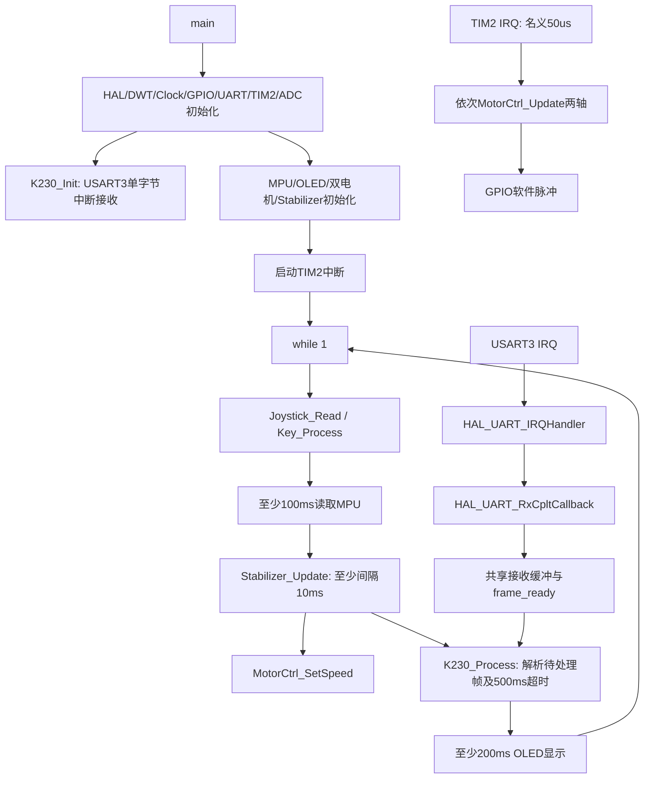

# 二维视觉云台完整工程分析报告

审查日期：2026-10-29（Asia/Singapore）  
工程：STM32F103C8T6 + K230，HAL，Keil MDK / ARM Compiler 5  
审查性质：源码静态审查、工程引用检查、宿主侧逻辑复现。未修改原源码、配置或业务功能，未连接或烧录硬件。

**结论：当前工程是“最大红色色块的双轴视觉追踪原型”，不能直接作为本题完整参赛程序。** A/B/C/D 共同依赖的数字 ID 识别、指定 ID 输入与选择、比赛任务状态机尚未实现；统一零位、实际轴角反馈和扫描范围也没有完整证据。已有采集、串口、双轴脉冲控制和像素误差控制可以复用。应先补齐目标身份与任务流程，再优化速度和精度，不能靠调整现有追踪参数补齐比赛功能。

依据：K230 的 `find_blobs → max(pixels)` 与六字段发送逻辑 [k230视觉云台.py:67-118](<F:/A_LIU_Astrspire/A_competition/Gimbal/STM32代码/k230视觉云台.py:67>)；STM32 的 `Stabilizer_Update` 仅有摇杆、单目标追踪、无目标停机三个分支 [HARDWARE/STABILIZER/stabilizer.c:78-202](<F:/A_LIU_Astrspire/A_competition/Gimbal/STM32代码/8.目标追踪【闭环】/HARDWARE/STABILIZER/stabilizer.c:78>)；电机初始化只清软件步数 [HARDWARE/MORTOR/motor.c:71-102](<F:/A_LIU_Astrspire/A_competition/Gimbal/STM32代码/8.目标追踪【闭环】/HARDWARE/MORTOR/motor.c:71>)。

## 审查口径与证据边界

- 工程根目录：`F:\A_LIU_Astrspire\A_competition\Gimbal\STM32代码\8.目标追踪【闭环】`。
- 实际视觉脚本：`F:\A_LIU_Astrspire\A_competition\Gimbal\STM32代码\k230视觉云台.py`。
- 比赛依据：[B题-二维云台.pdf](<F:/微信下载/xwechat_files/wxid_y5w1ikriprt322_c3f0/msg/attach/31de61a85e3852d0156e9fddf8b9259f/2026-10/Rec/066015175a490b24/F/0/B题-二维云台.pdf>)，共 4 页，已提取文本并在内存中渲染四页复核。文档内容仅作为赛题资料，不作为执行命令。
- 已查工程和上级目录，未发现磁盘上的 `AGENTS.md`，按用户在会话中提供的工程规范执行。现有开发指南另有“保留历史阶段、不要盲删供应商文件、最新不代表实测通过”等约定 [仓库整理与开发指南.md:34-45](<F:/A_LIU_Astrspire/A_competition/Gimbal/STM32代码/docs/仓库整理与开发指南.md:34>) [仓库整理与开发指南.md:59-76](<F:/A_LIU_Astrspire/A_competition/Gimbal/STM32代码/docs/仓库整理与开发指南.md:59>)。
- 项目不是当前可访问的 Git 仓库，`git status` 返回 `fatal: not a git repository`，因此采用文件哈希核对原文件，而非用不存在的 Git 差异证明未修改。
- “已实现”只指静态代码路径存在；不等于该能力已在实物上验收。“确定性错误”指给定条件下源码逻辑可推出；“条件风险”依赖中断时序、输入或实物；“无法确认”指缺少必要材料或测量。
- 未把 `_encoding_backup_20261025` 内的旧代码当作当前程序；未把 CMSIS DSP/NN/RTOS 示例或文件名中的“闭环”当作产品功能。
- 所有源代码行号均针对本次实际文件、从 1 开始；引用链接指向实际绝对路径。未能读取的外部工具和 Pack 列在附录。

### 赛题中必须保留的规则缺口

PDF 第 3 页的 B 项同时出现“3 次锁定共 18 分”“每次满分 7 分”和速度 4 分、保持 2 分的细则，数字不一致；本报告保留原文，不自行把其中某个数字改成正式规则。PDF 未给出“有效居中”的像素、归一化坐标或目标框覆盖标准。用户已确认按“标明争议、待裁判确认”处理。

PDF 第 2 页标题为“参考硬件”，列出实际角度反馈、位置控制、角速度适配接口及原始视频录制能力。报告据此分析差距；“参考”是否全部作为强制验收条款，应由裁判确认。不能因此擅自更换芯片、引脚或采购硬件。PDF 第 4 页的硬件机械额外加分没有可供源码量化的细则，不纳入伪造总分。

## 1. 工程架构

### 1.1 实际文件结构与构建入口

以下为当前文件扫描所得，省略供应商库的逐文件展开；覆盖范围见附录 A。

```text
Gimbal/
├── 二维视觉云台_完整工程分析报告.md      本次唯一新增交付物
└── STM32代码/
    ├── k230视觉云台.py                   实际 K230 脚本
    ├── docs/                            历史开发指南、物资清单
    ├── 7.目标追踪【开环】/               另一历史工程，不混用其配置
    └── 8.目标追踪【闭环】/               本次 STM32 审查对象
        ├── Core/Inc/                    main/gpio/usart/it/hal_conf 头文件
        ├── Core/Src/                    main/gpio/usart/it/hal_msp/system
        ├── HARDWARE/
        │   ├── APP/                     app.c/h：调度辅助、TIM2、显示、时钟
        │   ├── K230/                    k230.c/h：USART3接收、组帧、CSV解析
        │   ├── MORTOR/                  motor.c/h：PUL/DIR/ENA与软件步数
        │   ├── STABILIZER/              stabilizer.c/h：摇杆与像素误差追踪
        │   ├── MPU6050/                 mpu6050.c/h：软件I2C、姿态估计、显示
        │   ├── ADC/                     adc.c/h：摇杆采样与四点平均
        │   ├── OLED/                    oled.c/h、字体与图像数据
        │   └── DWT_DELAY/               内联DWT时基；dwt_delay.c为空实现单元
        ├── Drivers/                     HAL、CMSIS及未使用的示例/支持文件
        ├── MDK-ARM/
        │   ├── LED.uvprojx              实际 Keil 工程，Target=LED
        │   ├── startup_stm32f103xb.s     启动与向量表
        │   ├── DebugConfig/             调试配置，本次未启动
        │   └── LED/                     既存AXF/HEX/MAP/链接配置/历史日志
        ├── LED.ioc                      与手写代码不完全同步
        ├── _encoding_backup_20261025/    编码备份，非当前编译源码
        ├── 编码转换报告.md               历史说明，不作为本轮功能证据
        ├── _mxproject
        └── keilkill.bat                  未执行
```

Keil 配置为 `STM32F103C8`、ARM Compiler `5.06 update 7 build 960`、`uAC6=0`，启用 C99、MicroLIB、`USE_HAL_DRIVER,STM32F103xB`。XML 实际包含 **28 个 C 编译单元、1 个汇编单元、8 个头文件条目**；28 个 C 和启动汇编均存在，Core/HARDWARE 的 14 个 C 没有漏编。14 项 IncludePath 均存在，其中 K230 路径重复一次。依据：[MDK-ARM/LED.uvprojx:10-21](<F:/A_LIU_Astrspire/A_competition/Gimbal/STM32代码/8.目标追踪【闭环】/MDK-ARM/LED.uvprojx:10>) [MDK-ARM/LED.uvprojx:193](<F:/A_LIU_Astrspire/A_competition/Gimbal/STM32代码/8.目标追踪【闭环】/MDK-ARM/LED.uvprojx:193>) [MDK-ARM/LED.uvprojx:329-343](<F:/A_LIU_Astrspire/A_competition/Gimbal/STM32代码/8.目标追踪【闭环】/MDK-ARM/LED.uvprojx:329>)，以及本轮 XML 文件引用逐项检查。

### 1.2 实际主程序调用关系



`main` 先执行 `Stabilizer_Update`，后执行 `K230_Process`，因此新解析的视觉结果通常到下一轮才进入控制；不能描述成“接收中断直接闭环调速”。MPU 读数独立供显示，没有进入追踪计算。证据：[Core/Src/main.c:56-102](<F:/A_LIU_Astrspire/A_competition/Gimbal/STM32代码/8.目标追踪【闭环】/Core/Src/main.c:56>) [HARDWARE/APP/app.c:55-60](<F:/A_LIU_Astrspire/A_competition/Gimbal/STM32代码/8.目标追踪【闭环】/HARDWARE/APP/app.c:55>) [HARDWARE/STABILIZER/stabilizer.c:20-25](<F:/A_LIU_Astrspire/A_competition/Gimbal/STM32代码/8.目标追踪【闭环】/HARDWARE/STABILIZER/stabilizer.c:20>) [HARDWARE/STABILIZER/stabilizer.c:78-202](<F:/A_LIU_Astrspire/A_competition/Gimbal/STM32代码/8.目标追踪【闭环】/HARDWARE/STABILIZER/stabilizer.c:78>) [Core/Src/usart.c:121-124](<F:/A_LIU_Astrspire/A_competition/Gimbal/STM32代码/8.目标追踪【闭环】/Core/Src/usart.c:121>) [HARDWARE/K230/k230.c:46-95](<F:/A_LIU_Astrspire/A_competition/Gimbal/STM32代码/8.目标追踪【闭环】/HARDWARE/K230/k230.c:46>)。

### 1.3 主要模块逐函数审查

#### 1.3.1 主程序、APP、时钟和中断

| 函数/接口 | 实际行为与审查结果 | 证据 |
|---|---|---|
| `main` 初始化段 | HAL、DWT先于72MHz时钟；随后初始化外设、视觉、MPU、OLED、双电机。提示等待结束才启动TIM2。没有比赛启动指令或机械寻零 | [Core/Src/main.c:13-50](<F:/A_LIU_Astrspire/A_competition/Gimbal/STM32代码/8.目标追踪【闭环】/Core/Src/main.c:13>) |
| `main` 循环段 | 每圈先阻塞读摇杆；按键切页；至少100ms读MPU；稳定器、帧解析、至少200ms显示。50秒处理DWT存在单位错误 | [Core/Src/main.c:56-102](<F:/A_LIU_Astrspire/A_competition/Gimbal/STM32代码/8.目标追踪【闭环】/Core/Src/main.c:56>) |
| `MX_TIM2_Init` | PSC=71、ARR=49；按72MHz TIM2时钟，50µs/20kHz更新；最终IRQ优先级2 | [HARDWARE/APP/app.c:34-52](<F:/A_LIU_Astrspire/A_competition/Gimbal/STM32代码/8.目标追踪【闭环】/HARDWARE/APP/app.c:34>) |
| `HAL_TIM_PeriodElapsedCallback` | 只对TIM2依次更新两轴，无视觉、姿态或比赛状态计算 | [HARDWARE/APP/app.c:55-61](<F:/A_LIU_Astrspire/A_competition/Gimbal/STM32代码/8.目标追踪【闭环】/HARDWARE/APP/app.c:55>) |
| `Key_Process` | 摇杆按键按下/松开分别20ms消抖，产生单击事件；没有数字ID菜单 | [HARDWARE/APP/app.c:64-88](<F:/A_LIU_Astrspire/A_competition/Gimbal/STM32代码/8.目标追踪【闭环】/HARDWARE/APP/app.c:64>) [HARDWARE/APP/app.h:27-35](<F:/A_LIU_Astrspire/A_competition/Gimbal/STM32代码/8.目标追踪【闭环】/HARDWARE/APP/app.h:27>) |
| `Motor_All_Stop` | 使能两驱动器并清运行标志，维持ENA有效；不是断电停机，也没有减速轨迹 | [HARDWARE/APP/app.c:91-99](<F:/A_LIU_Astrspire/A_competition/Gimbal/STM32代码/8.目标追踪【闭环】/HARDWARE/APP/app.c:91>) |
| `Update_OLED_Display` | 第0页显示目标几何量/摇杆/脉冲间隔，第1页调用姿态显示；没有巡检ID列表或比赛结果 | [HARDWARE/APP/app.c:102-122](<F:/A_LIU_Astrspire/A_competition/Gimbal/STM32代码/8.目标追踪【闭环】/HARDWARE/APP/app.c:102>) |
| `SystemClock_Config` | HSE、PLL×9、AHB不分频、APB1÷2、APB2不分频；在8MHz HSE条件下72/36/72MHz；未设置ADC分频 | [HARDWARE/APP/app.c:125-144](<F:/A_LIU_Astrspire/A_competition/Gimbal/STM32代码/8.目标追踪【闭环】/HARDWARE/APP/app.c:125>) |
| `Error_Handler` | 关中断后死循环；如果运行中进入，不能依赖后续调度自动停机 | [HARDWARE/APP/app.c:147-151](<F:/A_LIU_Astrspire/A_competition/Gimbal/STM32代码/8.目标追踪【闭环】/HARDWARE/APP/app.c:147>) |
| `assert_failed` | 仅在`USE_FULL_ASSERT`启用时存在，函数体为空 | [HARDWARE/APP/app.c:153-157](<F:/A_LIU_Astrspire/A_competition/Gimbal/STM32代码/8.目标追踪【闭环】/HARDWARE/APP/app.c:153>) |
| `HAL_MspInit` | 使能AFIO/PWR，关闭JTAG保留SWD，释放PA15/PB4 | [Core/Src/stm32f1xx_hal_msp.c:63-81](<F:/A_LIU_Astrspire/A_competition/Gimbal/STM32代码/8.目标追踪【闭环】/Core/Src/stm32f1xx_hal_msp.c:63>) |
| `HAL_TIM_Base_MspInit/DeInit` | 开关TIM2时钟和IRQ；MSP先设优先级0，后被APP改成2 | [Core/Src/stm32f1xx_hal_msp.c:84-107](<F:/A_LIU_Astrspire/A_competition/Gimbal/STM32代码/8.目标追踪【闭环】/Core/Src/stm32f1xx_hal_msp.c:84>) [HARDWARE/APP/app.c:50-51](<F:/A_LIU_Astrspire/A_competition/Gimbal/STM32代码/8.目标追踪【闭环】/HARDWARE/APP/app.c:50>) |
| `MX_GPIO_Init` | 配LED、OLED、PB4/PA12外部按键；OLED使用推挽输出 | [Core/Src/gpio.c:42-102](<F:/A_LIU_Astrspire/A_competition/Gimbal/STM32代码/8.目标追踪【闭环】/Core/Src/gpio.c:42>) |
| `HAL_GPIO_EXTI_Callback` | KEY1/KEY2只翻转LED，不是裁判ID输入或开始事件 | [Core/Src/gpio.c:105-115](<F:/A_LIU_Astrspire/A_competition/Gimbal/STM32代码/8.目标追踪【闭环】/Core/Src/gpio.c:105>) |
| `NMI/HardFault/MemManage/BusFault/UsageFault_Handler` | 标准异常入口；故障死循环没有比赛故障状态上报 | [Core/Src/stm32f1xx_it.c:69-139](<F:/A_LIU_Astrspire/A_competition/Gimbal/STM32代码/8.目标追踪【闭环】/Core/Src/stm32f1xx_it.c:69>) |
| `SVC/DebugMon/PendSV_Handler` | 空入口；没有由此证明RTOS任务存在 | [Core/Src/stm32f1xx_it.c:144-179](<F:/A_LIU_Astrspire/A_competition/Gimbal/STM32代码/8.目标追踪【闭环】/Core/Src/stm32f1xx_it.c:144>) |
| `SysTick_Handler` | 递增HAL毫秒计数；不是固定100Hz视觉控制入口 | [Core/Src/stm32f1xx_it.c:183-192](<F:/A_LIU_Astrspire/A_competition/Gimbal/STM32代码/8.目标追踪【闭环】/Core/Src/stm32f1xx_it.c:183>) |
| `EXTI4/EXTI15_10/TIM2_IRQHandler` | 分别转入HAL GPIO/TIM处理，链路存在 | [Core/Src/stm32f1xx_it.c:205-236](<F:/A_LIU_Astrspire/A_competition/Gimbal/STM32代码/8.目标追踪【闭环】/Core/Src/stm32f1xx_it.c:205>) |
| `SystemInit/SystemCoreClockUpdate` | 启动文件调用系统初始化；HAL切时钟后更新核心时钟。初始`SystemCoreClock=16000000`与F103 HSI复位基准不一致，仅影响启动前段，不能说全程为16MHz | [Core/Src/system_stm32f1xx.c:142](<F:/A_LIU_Astrspire/A_competition/Gimbal/STM32代码/8.目标追踪【闭环】/Core/Src/system_stm32f1xx.c:142>) [MDK-ARM/startup_stm32f103xb.s:129-136](<F:/A_LIU_Astrspire/A_competition/Gimbal/STM32代码/8.目标追踪【闭环】/MDK-ARM/startup_stm32f103xb.s:129>) [HARDWARE/APP/app.c:125-144](<F:/A_LIU_Astrspire/A_competition/Gimbal/STM32代码/8.目标追踪【闭环】/HARDWARE/APP/app.c:125>) |

#### 1.3.2 电机和DWT

| 函数 | 实际行为与审查结果 | 证据 |
|---|---|---|
| `Motor_GPIO_Init` | PUL/DIR/ENA推挽；ENA低使能。只按PUL端口开时钟，当前依赖此前GPIO初始化已开GPIOA | [HARDWARE/MORTOR/motor.c:15-37](<F:/A_LIU_Astrspire/A_competition/Gimbal/STM32代码/8.目标追踪【闭环】/HARDWARE/MORTOR/motor.c:15>) |
| `Motor_Enable/Disable` | ENA低/高；是否符合实物驱动器有效电平未验证 | [HARDWARE/MORTOR/motor.c:39-47](<F:/A_LIU_Astrspire/A_competition/Gimbal/STM32代码/8.目标追踪【闭环】/HARDWARE/MORTOR/motor.c:39>) |
| `Motor_SetDir` | CW=低、CCW=高，随后140次忙等；不能仅凭循环数给出精确建立时间 | [HARDWARE/MORTOR/motor.c:49-56](<F:/A_LIU_Astrspire/A_competition/Gimbal/STM32代码/8.目标追踪【闭环】/HARDWARE/MORTOR/motor.c:49>) |
| `Motor_SinglePulse` | GPIO置高、140次循环、置低、70次循环；不是硬件PWM | [HARDWARE/MORTOR/motor.c:58-68](<F:/A_LIU_Astrspire/A_competition/Gimbal/STM32代码/8.目标追踪【闭环】/HARDWARE/MORTOR/motor.c:58>) |
| `MotorCtrl_Init` | 软件步数/home清零，初始间隔7000µs；没有物理零位检测 | [HARDWARE/MORTOR/motor.c:71-86](<F:/A_LIU_Astrspire/A_competition/Gimbal/STM32代码/8.目标追踪【闭环】/HARDWARE/MORTOR/motor.c:71>) |
| `MotorCtrl_SetHome` | 只记录当前软件步数，不测真实角度 | [HARDWARE/MORTOR/motor.c:88-91](<F:/A_LIU_Astrspire/A_competition/Gimbal/STM32代码/8.目标追踪【闭环】/HARDWARE/MORTOR/motor.c:88>) |
| `MotorCtrl_GoHome` | 软件步差转换相对圈数；未被主流程调用，且到位判断存在正侧回零错误 | [HARDWARE/MORTOR/motor.c:93-102](<F:/A_LIU_Astrspire/A_competition/Gimbal/STM32代码/8.目标追踪【闭环】/HARDWARE/MORTOR/motor.c:93>) [HARDWARE/MORTOR/motor.c:191-195](<F:/A_LIU_Astrspire/A_competition/Gimbal/STM32代码/8.目标追踪【闭环】/HARDWARE/MORTOR/motor.c:191>) |
| `MotorCtrl_SetTarget` | 相对圈数×20000得到相对步数；方向主要由圈数符号决定，`dir`参数只在零步数使用；只限最小间隔 | [HARDWARE/MORTOR/motor.c:105-128](<F:/A_LIU_Astrspire/A_competition/Gimbal/STM32代码/8.目标追踪【闭环】/HARDWARE/MORTOR/motor.c:105>) |
| `MotorCtrl_SetSpeed` | 用±999999步近似连续运行；反向先清运行标志，再由后续调用启动；覆盖上层加速度设置 | [HARDWARE/MORTOR/motor.c:131-157](<F:/A_LIU_Astrspire/A_competition/Gimbal/STM32代码/8.目标追踪【闭环】/HARDWARE/MORTOR/motor.c:131>) |
| `MotorCtrl_Update` | 每至少1ms调整脉冲间隔；每50µs轮询到期发一个脉冲；步数按方向累加。到位条件与时基有错；停止后不再发减速脉冲 | [HARDWARE/MORTOR/motor.c:159-207](<F:/A_LIU_Astrspire/A_competition/Gimbal/STM32代码/8.目标追踪【闭环】/HARDWARE/MORTOR/motor.c:159>) |
| `MotorCtrl_GetCircles` | 已发脉冲软件计数÷20000，不能当实测轴角反馈 | [HARDWARE/MORTOR/motor.c:209-212](<F:/A_LIU_Astrspire/A_competition/Gimbal/STM32代码/8.目标追踪【闭环】/HARDWARE/MORTOR/motor.c:209>) |
| `MotorCtrl_IsRunning` | `is_running \|\| pulse_delay<8000`，停止时可持续报运行 | [HARDWARE/MORTOR/motor.c:214-218](<F:/A_LIU_Astrspire/A_competition/Gimbal/STM32代码/8.目标追踪【闭环】/HARDWARE/MORTOR/motor.c:214>) |
| `DWT_Init/DWT_GetTickUs` | 头文件内联启动CYCCNT、除以时钟得到微秒；低层32位周期回绕没有扩展为单调微秒 | [HARDWARE/DWT_DELAY/dwt_delay.h:14-25](<F:/A_LIU_Astrspire/A_competition/Gimbal/STM32代码/8.目标追踪【闭环】/HARDWARE/DWT_DELAY/dwt_delay.h:14>) |

#### 1.3.3 稳定器、串口和K230接口

| 函数 | 实际行为与审查结果 | 证据 |
|---|---|---|
| `delay_from_joystick` | 摇杆偏移按分段曲线映射脉冲间隔；不是轴位置控制 | [HARDWARE/STABILIZER/stabilizer.c:40-49](<F:/A_LIU_Astrspire/A_competition/Gimbal/STM32代码/8.目标追踪【闭环】/HARDWARE/STABILIZER/stabilizer.c:40>) |
| `track_delay_from_error` | 归一化像素误差经三次曲线映射500～5500µs；不是PID。图像半宽/高必须为正 | [HARDWARE/STABILIZER/stabilizer.c:57-68](<F:/A_LIU_Astrspire/A_competition/Gimbal/STM32代码/8.目标追踪【闭环】/HARDWARE/STABILIZER/stabilizer.c:57>) |
| `Stabilizer_Init` | 清运行历史、滤波误差和调度时间 | [HARDWARE/STABILIZER/stabilizer.c:70-76](<F:/A_LIU_Astrspire/A_competition/Gimbal/STM32代码/8.目标追踪【闭环】/HARDWARE/STABILIZER/stabilizer.c:70>) |
| `Stabilizer_Update` | 至少10ms调用一次；摇杆最高优先级，否则跟随有效单目标，否则立即停；没有比赛状态机 | [HARDWARE/STABILIZER/stabilizer.c:78-202](<F:/A_LIU_Astrspire/A_competition/Gimbal/STM32代码/8.目标追踪【闭环】/HARDWARE/STABILIZER/stabilizer.c:78>) |
| `MX_USART1_UART_Init` | 115200 8N1调试口；配置RX不等于实现接收业务 | [Core/Src/usart.c:20-34](<F:/A_LIU_Astrspire/A_competition/Gimbal/STM32代码/8.目标追踪【闭环】/Core/Src/usart.c:20>) |
| `MX_USART3_UART_Init` | 115200 8N1视觉串口 | [Core/Src/usart.c:37-51](<F:/A_LIU_Astrspire/A_competition/Gimbal/STM32代码/8.目标追踪【闭环】/Core/Src/usart.c:37>) |
| `HAL_UART_MspInit/DeInit` | USART1 PA9/10；USART3 PB10/11；仅视觉口在这里启用NVIC，优先级0 | [Core/Src/usart.c:53-106](<F:/A_LIU_Astrspire/A_competition/Gimbal/STM32代码/8.目标追踪【闭环】/Core/Src/usart.c:53>) |
| `fputc` | USART1逐字符阻塞发送，超时`0xFFFF`，返回值未体现HAL发送失败 | [Core/Src/usart.c:109-113](<F:/A_LIU_Astrspire/A_competition/Gimbal/STM32代码/8.目标追踪【闭环】/Core/Src/usart.c:109>) |
| `USART1/USART3_IRQHandler` | 均在usart.c中转HAL；不能因it.c无同名入口就误报中断缺失 | [Core/Src/usart.c:115-124](<F:/A_LIU_Astrspire/A_competition/Gimbal/STM32代码/8.目标追踪【闭环】/Core/Src/usart.c:115>) |
| `K230_Init` | 初始化USART3并挂接1字节中断接收；未检查接收启动返回值 | [HARDWARE/K230/k230.c:35-41](<F:/A_LIU_Astrspire/A_competition/Gimbal/STM32代码/8.目标追踪【闭环】/HARDWARE/K230/k230.c:35>) |
| `HAL_UART_RxCpltCallback` | AA55/CRLF单字节状态机，写同一接收数组并置ready，随后重挂接接收 | [HARDWARE/K230/k230.c:62-95](<F:/A_LIU_Astrspire/A_competition/Gimbal/STM32代码/8.目标追踪【闭环】/HARDWARE/K230/k230.c:62>) |
| `K230_Process` | 主循环解析共享数组；成功帧超过500ms未更新则清valid，没有半帧状态超时复位 | [HARDWARE/K230/k230.c:46-57](<F:/A_LIU_Astrspire/A_competition/Gimbal/STM32代码/8.目标追踪【闭环】/HARDWARE/K230/k230.c:46>) |
| `Parse_K230_Data` | `%hd`解析6项；目标字段直接写全局，失败可部分写入；无ID、置信度、CRC、范围验证 | [HARDWARE/K230/k230.c:100-129](<F:/A_LIU_Astrspire/A_competition/Gimbal/STM32代码/8.目标追踪【闭环】/HARDWARE/K230/k230.c:100>) |
| K230 Python主流程 | UART、采集、显示初始化后循环红色色块检测；无自定义数字推理函数、无串口命令接收、无录像流程 | [k230视觉云台.py:1-132](<F:/A_LIU_Astrspire/A_competition/Gimbal/STM32代码/k230视觉云台.py:1>) |

#### 1.3.4 MPU6050、ADC与OLED支持模块

| 函数/函数组 | 实际行为与审查结果 | 证据 |
|---|---|---|
| MPU `I2C_Delay` | 10次NOP循环，不构成已测I2C频率 | [HARDWARE/MPU6050/mpu6050.c:15-19](<F:/A_LIU_Astrspire/A_competition/Gimbal/STM32代码/8.目标追踪【闭环】/HARDWARE/MPU6050/mpu6050.c:15>) |
| `I2C_GPIO_Init/Start/Stop` | PB6/PB7开漏软件I2C；外部上拉、上升沿、安装接线未知 | [HARDWARE/MPU6050/mpu6050.c:21-49](<F:/A_LIU_Astrspire/A_competition/Gimbal/STM32代码/8.目标追踪【闭环】/HARDWARE/MPU6050/mpu6050.c:21>) |
| `I2C_SendByte/ReadByte` | 实现字节与ACK/NACK；不等SCL实际拉高，无时钟拉伸/总线恢复 | [HARDWARE/MPU6050/mpu6050.c:51-88](<F:/A_LIU_Astrspire/A_competition/Gimbal/STM32代码/8.目标追踪【闭环】/HARDWARE/MPU6050/mpu6050.c:51>) |
| `MPU6050_WriteReg/ReadReg` | 有地址/寄存器ACK失败返回；读使用重复起始 | [HARDWARE/MPU6050/mpu6050.c:90-110](<F:/A_LIU_Astrspire/A_competition/Gimbal/STM32代码/8.目标追踪【闭环】/HARDWARE/MPU6050/mpu6050.c:90>) |
| `MPU6050_CalculateAngle` | 互补滤波、固定DT=0.1；加速度与角速度轴未正确配对，无零偏校准，yaw仅积分 | [HARDWARE/MPU6050/mpu6050.c:8-13](<F:/A_LIU_Astrspire/A_competition/Gimbal/STM32代码/8.目标追踪【闭环】/HARDWARE/MPU6050/mpu6050.c:8>) [HARDWARE/MPU6050/mpu6050.c:112-135](<F:/A_LIU_Astrspire/A_competition/Gimbal/STM32代码/8.目标追踪【闭环】/HARDWARE/MPU6050/mpu6050.c:112>) |
| `MPU6050_Init` | 复位/唤醒、量程与滤波配置；忽略写寄存器失败，不读WHO_AM_I，仍打印完成 | [HARDWARE/MPU6050/mpu6050.c:137-150](<F:/A_LIU_Astrspire/A_competition/Gimbal/STM32代码/8.目标追踪【闭环】/HARDWARE/MPU6050/mpu6050.c:137>) |
| `MPU6050_ReadData` | 14字节读取后转换并估计姿态，失败返回1；main忽略该返回值 | [HARDWARE/MPU6050/mpu6050.c:152-164](<F:/A_LIU_Astrspire/A_competition/Gimbal/STM32代码/8.目标追踪【闭环】/HARDWARE/MPU6050/mpu6050.c:152>) [Core/Src/main.c:81-85](<F:/A_LIU_Astrspire/A_competition/Gimbal/STM32代码/8.目标追踪【闭环】/Core/Src/main.c:81>) |
| `MPU6050_Display` | 17字节缓冲装入至少20字节字符串，存在确定越界 | [HARDWARE/MPU6050/mpu6050.c:166-176](<F:/A_LIU_Astrspire/A_competition/Gimbal/STM32代码/8.目标追踪【闭环】/HARDWARE/MPU6050/mpu6050.c:166>) |
| `FilterJoy` | 四点平均；输入采样节奏跟随主循环，滤波时间常数不固定 | [HARDWARE/ADC/adc.c:3-14](<F:/A_LIU_Astrspire/A_competition/Gimbal/STM32代码/8.目标追踪【闭环】/HARDWARE/ADC/adc.c:3>) |
| `MX_ADC1_Init` | PA4/5模拟、PA7按键；直接寄存器ADC初始化。未配ADC分频，采样时间位写错通道，校准无限等待 | [HARDWARE/ADC/adc.c:16-42](<F:/A_LIU_Astrspire/A_competition/Gimbal/STM32代码/8.目标追踪【闭环】/HARDWARE/ADC/adc.c:16>) |
| `ADC_ReadRaw` | SQR3选通道，以ADON启动，等待EOC无超时 | [HARDWARE/ADC/adc.c:44-50](<F:/A_LIU_Astrspire/A_competition/Gimbal/STM32代码/8.目标追踪【闭环】/HARDWARE/ADC/adc.c:44>) |
| `ADC_ConvertTo100` | 12位采样映射0～100并限上界 | [HARDWARE/ADC/adc.c:52-57](<F:/A_LIU_Astrspire/A_competition/Gimbal/STM32代码/8.目标追踪【闭环】/HARDWARE/ADC/adc.c:52>) |
| `Joystick_K_Read/Joystick_Read` | PA7按键；通道4/5采样、缩放、四点平均；主循环每圈执行 | [HARDWARE/ADC/adc.c:59-74](<F:/A_LIU_Astrspire/A_competition/Gimbal/STM32代码/8.目标追踪【闭环】/HARDWARE/ADC/adc.c:59>) |
| OLED `IIC_Start/Stop/Wait_Ack/Write_IIC_Byte` | 软件I2C；ACK函数仅翻转SCL，未释放/采样SDA | [HARDWARE/OLED/oled.c:43-110](<F:/A_LIU_Astrspire/A_competition/Gimbal/STM32代码/8.目标追踪【闭环】/HARDWARE/OLED/oled.c:43>) |
| `Write_IIC_Command/Data/OLED_WR_Byte` | 每个字节独立发送地址、控制字、数据、STOP；没有错误返回 | [HARDWARE/OLED/oled.c:114-153](<F:/A_LIU_Astrspire/A_competition/Gimbal/STM32代码/8.目标追踪【闭环】/HARDWARE/OLED/oled.c:114>) |
| `OLED_Set_Pos/Display_On/Display_Off/Clear/On` | 寄存器定位、开关显示、整屏逐字节写入；为同步阻塞调用 | [HARDWARE/OLED/oled.c:194-235](<F:/A_LIU_Astrspire/A_competition/Gimbal/STM32代码/8.目标追踪【闭环】/HARDWARE/OLED/oled.c:194>) |
| `OLED_ShowChar/ShowString` | 字库查表写字符；字符串超16列会换行，没有屏幕页边界裁剪 | [HARDWARE/OLED/oled.c:241-261](<F:/A_LIU_Astrspire/A_competition/Gimbal/STM32代码/8.目标追踪【闭环】/HARDWARE/OLED/oled.c:241>) [HARDWARE/OLED/oled.c:295-304](<F:/A_LIU_Astrspire/A_competition/Gimbal/STM32代码/8.目标追踪【闭环】/HARDWARE/OLED/oled.c:295>) |
| `OLED_Init` | 软件初始化命令，含800ms启动等待；main另等1500ms | [HARDWARE/OLED/oled.c:341-393](<F:/A_LIU_Astrspire/A_competition/Gimbal/STM32代码/8.目标追踪【闭环】/HARDWARE/OLED/oled.c:341>) [Core/Src/main.c:43-50](<F:/A_LIU_Astrspire/A_competition/Gimbal/STM32代码/8.目标追踪【闭环】/Core/Src/main.c:43>) |
| `fill_picture/Delay_50ms/Delay_1ms/oled_pow/ShowNum/ShowCHinese/DrawBMP` | 支持函数存在，当前APP显示主链未调用这些绘图/延时入口；不将其视为数字视觉识别 | [HARDWARE/OLED/oled.c:159-190](<F:/A_LIU_Astrspire/A_competition/Gimbal/STM32代码/8.目标追踪【闭环】/HARDWARE/OLED/oled.c:159>) [HARDWARE/OLED/oled.c:263-293](<F:/A_LIU_Astrspire/A_competition/Gimbal/STM32代码/8.目标追踪【闭环】/HARDWARE/OLED/oled.c:263>) [HARDWARE/OLED/oled.c:306-338](<F:/A_LIU_Astrspire/A_competition/Gimbal/STM32代码/8.目标追踪【闭环】/HARDWARE/OLED/oled.c:306>) |

### 1.4 引脚、时钟与中断一致性

| 模块 | 源码实际配置 | 证据/限制 |
|---|---|---|
| 电机1 | PA0 PUL、PA1 DIR、PA2 ENA | [HARDWARE/MORTOR/motor.c:3-7](<F:/A_LIU_Astrspire/A_competition/Gimbal/STM32代码/8.目标追踪【闭环】/HARDWARE/MORTOR/motor.c:3>)；稳定器称Y轴，真实pitch对应待测 |
| 电机2 | PB0 PUL、PB1 DIR、PA3 ENA | [HARDWARE/MORTOR/motor.c:9-13](<F:/A_LIU_Astrspire/A_competition/Gimbal/STM32代码/8.目标追踪【闭环】/HARDWARE/MORTOR/motor.c:9>)；稳定器称X轴，真实yaw对应待测 |
| 摇杆 | PA4/PA5 ADC，PA7上拉按键 | [HARDWARE/ADC/adc.c:21-29](<F:/A_LIU_Astrspire/A_competition/Gimbal/STM32代码/8.目标追踪【闭环】/HARDWARE/ADC/adc.c:21>) [HARDWARE/ADC/adc.c:59-67](<F:/A_LIU_Astrspire/A_competition/Gimbal/STM32代码/8.目标追踪【闭环】/HARDWARE/ADC/adc.c:59>) |
| MPU6050 | PB6/PB7，软件开漏I2C | [HARDWARE/MPU6050/mpu6050.c:4-6](<F:/A_LIU_Astrspire/A_competition/Gimbal/STM32代码/8.目标追踪【闭环】/HARDWARE/MPU6050/mpu6050.c:4>) [HARDWARE/MPU6050/mpu6050.c:21-30](<F:/A_LIU_Astrspire/A_competition/Gimbal/STM32代码/8.目标追踪【闭环】/HARDWARE/MPU6050/mpu6050.c:21>) |
| OLED | PA15 SCL、PB12 SDA，当前推挽 | [Core/Inc/main.h:62-68](<F:/A_LIU_Astrspire/A_competition/Gimbal/STM32代码/8.目标追踪【闭环】/Core/Inc/main.h:62>) [Core/Src/gpio.c:70-87](<F:/A_LIU_Astrspire/A_competition/Gimbal/STM32代码/8.目标追踪【闭环】/Core/Src/gpio.c:70>) |
| USART1 | PA9 TX、PA10 RX，115200 8N1 | [Core/Src/usart.c:20-33](<F:/A_LIU_Astrspire/A_competition/Gimbal/STM32代码/8.目标追踪【闭环】/Core/Src/usart.c:20>) [Core/Src/usart.c:56-69](<F:/A_LIU_Astrspire/A_competition/Gimbal/STM32代码/8.目标追踪【闭环】/Core/Src/usart.c:56>) |
| USART3 | PB10 TX、PB11 RX，115200 8N1，IRQ=0 | [Core/Src/usart.c:37-50](<F:/A_LIU_Astrspire/A_competition/Gimbal/STM32代码/8.目标追踪【闭环】/Core/Src/usart.c:37>) [Core/Src/usart.c:72-88](<F:/A_LIU_Astrspire/A_competition/Gimbal/STM32代码/8.目标追踪【闭环】/Core/Src/usart.c:72>) |
| 外部按键/LED | PB4、PA12外部中断；PC13 LED | [Core/Inc/main.h:60-71](<F:/A_LIU_Astrspire/A_competition/Gimbal/STM32代码/8.目标追踪【闭环】/Core/Inc/main.h:60>) [Core/Src/gpio.c:89-115](<F:/A_LIU_Astrspire/A_competition/Gimbal/STM32代码/8.目标追踪【闭环】/Core/Src/gpio.c:89>) |
| TIM2 | 72MHz条件下50µs中断，最终优先级2 | [HARDWARE/APP/app.c:34-51](<F:/A_LIU_Astrspire/A_competition/Gimbal/STM32代码/8.目标追踪【闭环】/HARDWARE/APP/app.c:34>) |
| SysTick | HAL毫秒节拍，优先级15 | [Core/Inc/stm32f1xx_hal_conf.h:132](<F:/A_LIU_Astrspire/A_competition/Gimbal/STM32代码/8.目标追踪【闭环】/Core/Inc/stm32f1xx_hal_conf.h:132>) [Core/Src/stm32f1xx_it.c:183-192](<F:/A_LIU_Astrspire/A_competition/Gimbal/STM32代码/8.目标追踪【闭环】/Core/Src/stm32f1xx_it.c:183>) |
| SWD/JTAG | 保留SWD，关JTAG释放PA15/PB4 | [Core/Src/stm32f1xx_hal_msp.c:69-76](<F:/A_LIU_Astrspire/A_competition/Gimbal/STM32代码/8.目标追踪【闭环】/Core/Src/stm32f1xx_hal_msp.c:69>) |

未发现上述实际初始化之间的静态引脚复用冲突；PA7与PB7不是同一引脚。USART3和外部按键优先级高于TIM2，软件脉冲可被抢占，抖动需要测量。源码引脚一致不证明PCB连线、电平、驱动输入电流、使能有效电平或地线正确。

`.ioc` 只记录 NVIC/RCC/SYS/USART1，未覆盖手写USART3、ADC、TIM2及若干GPIO；当前运行配置应以实际C源码为准，不能重新生成后默认功能仍在。证据：[LED.ioc:7-11](<F:/A_LIU_Astrspire/A_competition/Gimbal/STM32代码/8.目标追踪【闭环】/LED.ioc:7>) [LED.ioc:113-114](<F:/A_LIU_Astrspire/A_competition/Gimbal/STM32代码/8.目标追踪【闭环】/LED.ioc:113>)，与上表交叉核对。

## 2. 现有功能完成情况

### 2.1 视觉、通信、运动与比赛能力清单

| 能力 | 状态 | 判断依据与实际限制 |
|---|---|---|
| 640×480 RGB565采集、显示 | 已实现 | `Sensor`配置、snapshot和show_image存在；相机实物/固件运行未验证 [k230视觉云台.py:13-14](<F:/A_LIU_Astrspire/A_competition/Gimbal/STM32代码/k230视觉云台.py:13>) [k230视觉云台.py:48-57](<F:/A_LIU_Astrspire/A_competition/Gimbal/STM32代码/k230视觉云台.py:48>) [k230视觉云台.py:70](<F:/A_LIU_Astrspire/A_competition/Gimbal/STM32代码/k230视觉云台.py:70>) [k230视觉云台.py:117-118](<F:/A_LIU_Astrspire/A_competition/Gimbal/STM32代码/k230视觉云台.py:117>) |
| 红色色块检测、框和中心 | 已实现 | find_blobs、最大pixels、cx/cy/w/h、叠图；不是数字识别 [k230视觉云台.py:73-97](<F:/A_LIU_Astrspire/A_competition/Gimbal/STM32代码/k230视觉云台.py:73>) |
| 0～9数字ID识别 | 未实现 | 完整脚本只有颜色检测，无模型加载、OCR或分类流程 [k230视觉云台.py:1-132](<F:/A_LIU_Astrspire/A_competition/Gimbal/STM32代码/k230视觉云台.py:1>) |
| 多目标同时检测与上报 | 部分实现 | 能得到多个色块，但仅发送最大一个；没有数字目标列表 [k230视觉云台.py:73-94](<F:/A_LIU_Astrspire/A_competition/Gimbal/STM32代码/k230视觉云台.py:73>) |
| ID/置信度/目标身份保持 | 未实现 | 两端只有图像尺寸和单框几何量 [k230视觉云台.py:89-108](<F:/A_LIU_Astrspire/A_competition/Gimbal/STM32代码/k230视觉云台.py:89>) [HARDWARE/K230/k230.h:6-18](<F:/A_LIU_Astrspire/A_competition/Gimbal/STM32代码/8.目标追踪【闭环】/HARDWARE/K230/k230.h:6>) |
| 原始视频录制、保存 | 未实现 | show_image不是编码/封装/写文件；完整脚本无保存链路 [k230视觉云台.py:1-132](<F:/A_LIU_Astrspire/A_competition/Gimbal/STM32代码/k230视觉云台.py:1>) |
| 固定曝光、增益 | 未实现 | 当前脚本未设置固定曝光/增益；固件默认行为未知 [k230视觉云台.py:48-57](<F:/A_LIU_Astrspire/A_competition/Gimbal/STM32代码/k230视觉云台.py:48>) |
| K230→STM32单向位置上报 | 已实现 | 双方115200 8N1、AA55/CSV/CRLF匹配；物理链路未验收 [k230视觉云台.py:23-40](<F:/A_LIU_Astrspire/A_competition/Gimbal/STM32代码/k230视觉云台.py:23>) [Core/Src/usart.c:37-50](<F:/A_LIU_Astrspire/A_competition/Gimbal/STM32代码/8.目标追踪【闭环】/Core/Src/usart.c:37>) [HARDWARE/K230/k230.c:62-129](<F:/A_LIU_Astrspire/A_competition/Gimbal/STM32代码/8.目标追踪【闭环】/HARDWARE/K230/k230.c:62>) |
| 无目标上报 | 已实现 | 四个目标字段全-1；valid表示收到可解析帧，并非必有目标 [k230视觉云台.py:95-97](<F:/A_LIU_Astrspire/A_competition/Gimbal/STM32代码/k230视觉云台.py:95>) [HARDWARE/K230/k230.c:118-127](<F:/A_LIU_Astrspire/A_competition/Gimbal/STM32代码/8.目标追踪【闭环】/HARDWARE/K230/k230.c:118>) [HARDWARE/STABILIZER/stabilizer.c:86-87](<F:/A_LIU_Astrspire/A_competition/Gimbal/STM32代码/8.目标追踪【闭环】/HARDWARE/STABILIZER/stabilizer.c:86>) |
| 帧解析、通信超时 | 部分实现 | 有6项解析和500ms数据超时；无CRC、组帧超时、完整快照、可靠恢复 [HARDWARE/K230/k230.c:46-129](<F:/A_LIU_Astrspire/A_competition/Gimbal/STM32代码/8.目标追踪【闭环】/HARDWARE/K230/k230.c:46>) |
| 双轴独立调速 | 已实现 | 两控制结构独立，误差X驱动motor2、Y驱动motor1；机械方向待测 [HARDWARE/APP/app.c:9-10](<F:/A_LIU_Astrspire/A_competition/Gimbal/STM32代码/8.目标追踪【闭环】/HARDWARE/APP/app.c:9>) [HARDWARE/APP/app.c:55-60](<F:/A_LIU_Astrspire/A_competition/Gimbal/STM32代码/8.目标追踪【闭环】/HARDWARE/APP/app.c:55>) [HARDWARE/STABILIZER/stabilizer.c:147-185](<F:/A_LIU_Astrspire/A_competition/Gimbal/STM32代码/8.目标追踪【闭环】/HARDWARE/STABILIZER/stabilizer.c:147>) |
| 双轴像素误差闭环 | 部分实现 | 有误差低通、死区和速度曲线；反馈低频且无ID，精度未实测 [HARDWARE/STABILIZER/stabilizer.c:147-185](<F:/A_LIU_Astrspire/A_competition/Gimbal/STM32代码/8.目标追踪【闭环】/HARDWARE/STABILIZER/stabilizer.c:147>) |
| 电机轴绝对角闭环 | 未实现 | STM32只累计发出的脉冲，无编码器/轴角读取入口 [HARDWARE/MORTOR/motor.h:20-32](<F:/A_LIU_Astrspire/A_competition/Gimbal/STM32代码/8.目标追踪【闭环】/HARDWARE/MORTOR/motor.h:20>) [HARDWARE/MORTOR/motor.c:159-212](<F:/A_LIU_Astrspire/A_competition/Gimbal/STM32代码/8.目标追踪【闭环】/HARDWARE/MORTOR/motor.c:159>) |
| 驱动器内部是否自带闭环 | 无法确认 | 历史物资清单涉及闭环电机产品，但不证明实物及反馈接入 [BOM_物资采购清单.md:3-10](<F:/A_LIU_Astrspire/A_competition/Gimbal/STM32代码/docs/BOM_物资采购清单.md:3>) [BOM_物资采购清单.md:29](<F:/A_LIU_Astrspire/A_competition/Gimbal/STM32代码/docs/BOM_物资采购清单.md:29>) [BOM_物资采购清单.md:38-49](<F:/A_LIU_Astrspire/A_competition/Gimbal/STM32代码/docs/BOM_物资采购清单.md:38>) |
| MPU采样与姿态显示 | 部分实现 | 有读取与互补滤波；轴配对/DT/错误处理和显示越界需修正 [HARDWARE/MPU6050/mpu6050.c:112-176](<F:/A_LIU_Astrspire/A_competition/Gimbal/STM32代码/8.目标追踪【闭环】/HARDWARE/MPU6050/mpu6050.c:112>) |
| MPU参与云台稳定控制 | 未实现 | stabilizer仅extern而不使用mpu_data，main只读取/显示 [HARDWARE/STABILIZER/stabilizer.c:20-25](<F:/A_LIU_Astrspire/A_competition/Gimbal/STM32代码/8.目标追踪【闭环】/HARDWARE/STABILIZER/stabilizer.c:20>) [HARDWARE/STABILIZER/stabilizer.c:78-202](<F:/A_LIU_Astrspire/A_competition/Gimbal/STM32代码/8.目标追踪【闭环】/HARDWARE/STABILIZER/stabilizer.c:78>) [Core/Src/main.c:81-95](<F:/A_LIU_Astrspire/A_competition/Gimbal/STM32代码/8.目标追踪【闭环】/Core/Src/main.c:81>) |
| 可重复物理零位 | 未实现 | 当前只置软件步数0；SetHome/GoHome未被任务流程调用 [HARDWARE/MORTOR/motor.c:71-102](<F:/A_LIU_Astrspire/A_competition/Gimbal/STM32代码/8.目标追踪【闭环】/HARDWARE/MORTOR/motor.c:71>) [Core/Src/main.c:32-40](<F:/A_LIU_Astrspire/A_competition/Gimbal/STM32代码/8.目标追踪【闭环】/Core/Src/main.c:32>) |
| yaw±60°/pitch±20°软限位 | 未实现 | 速度模式采用巨大步数终点，无轴角范围检查 [HARDWARE/MORTOR/motor.c:131-157](<F:/A_LIU_Astrspire/A_competition/Gimbal/STM32代码/8.目标追踪【闭环】/HARDWARE/MORTOR/motor.c:131>) [HARDWARE/STABILIZER/stabilizer.c:78-202](<F:/A_LIU_Astrspire/A_competition/Gimbal/STM32代码/8.目标追踪【闭环】/HARDWARE/STABILIZER/stabilizer.c:78>) |
| 裁判ID输入 | 未实现 | PA7单击切显示页；另两键翻LED；USART1无接收业务 [Core/Src/main.c:69-79](<F:/A_LIU_Astrspire/A_competition/Gimbal/STM32代码/8.目标追踪【闭环】/Core/Src/main.c:69>) [Core/Src/gpio.c:105-115](<F:/A_LIU_Astrspire/A_competition/Gimbal/STM32代码/8.目标追踪【闭环】/Core/Src/gpio.c:105>) [Core/Src/usart.c:20-124](<F:/A_LIU_Astrspire/A_competition/Gimbal/STM32代码/8.目标追踪【闭环】/Core/Src/usart.c:20>) |
| 自主扫描与60秒任务截止 | 未实现 | 无目标即停止；没有巡检任务和60秒结果冻结 [HARDWARE/STABILIZER/stabilizer.c:189-201](<F:/A_LIU_Astrspire/A_competition/Gimbal/STM32代码/8.目标追踪【闭环】/HARDWARE/STABILIZER/stabilizer.c:189>) [Core/Src/main.c:56-102](<F:/A_LIU_Astrspire/A_competition/Gimbal/STM32代码/8.目标追踪【闭环】/Core/Src/main.c:56>) |
| ID去重、误检验证、结果清单 | 未实现 | 无ID字段和对应任务数据结构 [HARDWARE/K230/k230.h:6-18](<F:/A_LIU_Astrspire/A_competition/Gimbal/STM32代码/8.目标追踪【闭环】/HARDWARE/K230/k230.h:6>) [HARDWARE/APP/app.h:8-37](<F:/A_LIU_Astrspire/A_competition/Gimbal/STM32代码/8.目标追踪【闭环】/HARDWARE/APP/app.h:8>) [HARDWARE/APP/app.c:64-122](<F:/A_LIU_Astrspire/A_competition/Gimbal/STM32代码/8.目标追踪【闭环】/HARDWARE/APP/app.c:64>) |
| 连续居中1秒、保持5秒、15秒锁定期限 | 未实现 | 现有8像素死区只控制停转，不计算这些比赛指标 [HARDWARE/STABILIZER/stabilizer.c:15-18](<F:/A_LIU_Astrspire/A_competition/Gimbal/STM32代码/8.目标追踪【闭环】/HARDWARE/STABILIZER/stabilizer.c:15>) [HARDWARE/STABILIZER/stabilizer.c:159-187](<F:/A_LIU_Astrspire/A_competition/Gimbal/STM32代码/8.目标追踪【闭环】/HARDWARE/STABILIZER/stabilizer.c:159>) |
| 移动预测和按新帧更新滤波 | 未实现 | 每个控制调用重复滤波，未用帧号或视觉速度 [HARDWARE/STABILIZER/stabilizer.c:79-80](<F:/A_LIU_Astrspire/A_competition/Gimbal/STM32代码/8.目标追踪【闭环】/HARDWARE/STABILIZER/stabilizer.c:79>) [HARDWARE/STABILIZER/stabilizer.c:147-157](<F:/A_LIU_Astrspire/A_competition/Gimbal/STM32代码/8.目标追踪【闭环】/HARDWARE/STABILIZER/stabilizer.c:147>) |
| 目标丢失处理 | 部分实现 | 显式无目标或超时后停机；没有遮挡状态、搜索或目标身份保留 [HARDWARE/K230/k230.c:53-56](<F:/A_LIU_Astrspire/A_competition/Gimbal/STM32代码/8.目标追踪【闭环】/HARDWARE/K230/k230.c:53>) [HARDWARE/STABILIZER/stabilizer.c:86-87](<F:/A_LIU_Astrspire/A_competition/Gimbal/STM32代码/8.目标追踪【闭环】/HARDWARE/STABILIZER/stabilizer.c:86>) [HARDWARE/STABILIZER/stabilizer.c:189-201](<F:/A_LIU_Astrspire/A_competition/Gimbal/STM32代码/8.目标追踪【闭环】/HARDWARE/STABILIZER/stabilizer.c:189>) |
| 同ID重捕获及8秒期限/3次测试 | 未实现 | 新出现任意最大红块即可重新跟随，没有ID再确认 [k230视觉云台.py:77-97](<F:/A_LIU_Astrspire/A_competition/Gimbal/STM32代码/k230视觉云台.py:77>) [HARDWARE/STABILIZER/stabilizer.c:133-201](<F:/A_LIU_Astrspire/A_competition/Gimbal/STM32代码/8.目标追踪【闭环】/HARDWARE/STABILIZER/stabilizer.c:133>) |
| 实际K230固件、模型兼容性 | 无法确认 | 注释写CanMV v1.2.2，不是设备读回；ST7701显示与所用板卡未验证 [k230视觉云台.py:3](<F:/A_LIU_Astrspire/A_competition/Gimbal/STM32代码/k230视觉云台.py:3>) [k230视觉云台.py:55-57](<F:/A_LIU_Astrspire/A_competition/Gimbal/STM32代码/k230视觉云台.py:55>) |

“部分实现”不意味着对应比赛任务已获得部分分数。比如两个电机能追踪红块，只能证明控制原型存在，不能证明指定数字跟踪成立。

### 2.2 工程可运行性与资源

1. **工程入口基本完整。** 编译单元、启动汇编及IncludePath存在；未发现当前启用模块直接缺失的本地头文件。唯一悬空的XML头文件条目是`LED.uvprojx`第476行的外部D盘`usart.h`，属于FileType=5；本地`Core/Inc/usart.h`存在并位于IncludePath，不能据此断言必然编译失败。报告不复写该冗长外部目录的无关文本。依据：[MDK-ARM/LED.uvprojx:343](<F:/A_LIU_Astrspire/A_competition/Gimbal/STM32代码/8.目标追踪【闭环】/MDK-ARM/LED.uvprojx:343>) [MDK-ARM/LED.uvprojx:473-476](<F:/A_LIU_Astrspire/A_competition/Gimbal/STM32代码/8.目标追踪【闭环】/MDK-ARM/LED.uvprojx:473>) [Core/Inc/usart.h:35-41](<F:/A_LIU_Astrspire/A_competition/Gimbal/STM32代码/8.目标追踪【闭环】/Core/Inc/usart.h:35>)。
2. **初始化不是全部使用HAL封装。** GPIO/UART/TIM使用HAL；摇杆ADC直接操作寄存器；MPU/OLED软件I2C。它们仍属于当前HAL工程，审查建议保留架构，不改为标准外设库。依据：[HARDWARE/ADC/adc.c:16-49](<F:/A_LIU_Astrspire/A_competition/Gimbal/STM32代码/8.目标追踪【闭环】/HARDWARE/ADC/adc.c:16>) [HARDWARE/MPU6050/mpu6050.c:21-110](<F:/A_LIU_Astrspire/A_competition/Gimbal/STM32代码/8.目标追踪【闭环】/HARDWARE/MPU6050/mpu6050.c:21>) [HARDWARE/OLED/oled.c:43-153](<F:/A_LIU_Astrspire/A_competition/Gimbal/STM32代码/8.目标追踪【闭环】/HARDWARE/OLED/oled.c:43>)。
3. **Flash/RAM配置正确指向C8容量。** 工程配置Flash `0x08000000+0x10000=64KiB`、RAM `0x20000000+0x5000=20KiB`；scatter一致，栈0x400、堆0x200。依据：[MDK-ARM/LED.uvprojx:247-255](<F:/A_LIU_Astrspire/A_competition/Gimbal/STM32代码/8.目标追踪【闭环】/MDK-ARM/LED.uvprojx:247>) [MDK-ARM/LED/LED.sct:5-14](<F:/A_LIU_Astrspire/A_competition/Gimbal/STM32代码/8.目标追踪【闭环】/MDK-ARM/LED/LED.sct:5>) [MDK-ARM/startup_stm32f103xb.s:33-44](<F:/A_LIU_Astrspire/A_competition/Gimbal/STM32代码/8.目标追踪【闭环】/MDK-ARM/startup_stm32f103xb.s:33>)。
4. **历史资源有余量，不代表当前重编通过。** 2026-10-25 14:34:49（+08:00）的历史构建记录Code=19196、RO=2588、RW=168、ZI=1440，0 errors/0 warnings；map列ROM=21952B、RW+ZI=1608B。链接ROM统计可含RW装载值及对齐，不宜简单把Code+RO当唯一Flash占用。当前代码本轮未重新编译。依据：[MDK-ARM/LED/LED.build_log.htm:29-35](<F:/A_LIU_Astrspire/A_competition/Gimbal/STM32代码/8.目标追踪【闭环】/MDK-ARM/LED/LED.build_log.htm:29>) [MDK-ARM/LED/LED.map:2524-2526](<F:/A_LIU_Astrspire/A_competition/Gimbal/STM32代码/8.目标追踪【闭环】/MDK-ARM/LED/LED.map:2524>)。
5. **栈安全不能仅靠静态估计保证。** 历史调用图给264B，同时标有Unknown(Cycles, Untraceable Function Pointers)；嵌套中断、格式化输出和已确定越界均须考虑。依据：[MDK-ARM/LED/LED.htm:8](<F:/A_LIU_Astrspire/A_competition/Gimbal/STM32代码/8.目标追踪【闭环】/MDK-ARM/LED/LED.htm:8>) [HARDWARE/MPU6050/mpu6050.c:166-175](<F:/A_LIU_Astrspire/A_competition/Gimbal/STM32代码/8.目标追踪【闭环】/HARDWARE/MPU6050/mpu6050.c:166>)。
6. **外部工具链和Pack未确认可用。** 本轮读取Keil/ARMCC/ARMLINK和部分Pack路径均被系统拒绝，故未执行隔离编译。XML请求CMSIS4.5.0/DFP2.3.0，而历史日志使用CMSIS6.3.0/DFP2.4.1，后续构建必须记录实际解析版本。依据：[MDK-ARM/LED.uvprojx:19](<F:/A_LIU_Astrspire/A_competition/Gimbal/STM32代码/8.目标追踪【闭环】/MDK-ARM/LED.uvprojx:19>) [MDK-ARM/LED.uvprojx:706-707](<F:/A_LIU_Astrspire/A_competition/Gimbal/STM32代码/8.目标追踪【闭环】/MDK-ARM/LED.uvprojx:706>) [MDK-ARM/LED/LED.build_log.htm:40-53](<F:/A_LIU_Astrspire/A_competition/Gimbal/STM32代码/8.目标追踪【闭环】/MDK-ARM/LED/LED.build_log.htm:40>)，以及附录C的访问结果。
7. **F103不适合承载整帧图像或数字推理。** 单张640×480 RGB565图像需614400B，远大于工程20KiB RAM；图像与识别必须留在K230。STM32仅收少量目标元数据和执行控制，当前历史资源支持这条分工路线，但新增功能最终占用仍需重新链接验证。依据：[k230视觉云台.py:13-14](<F:/A_LIU_Astrspire/A_competition/Gimbal/STM32代码/k230视觉云台.py:13>) [k230视觉云台.py:53](<F:/A_LIU_Astrspire/A_competition/Gimbal/STM32代码/k230视觉云台.py:53>) [MDK-ARM/LED.uvprojx:247-255](<F:/A_LIU_Astrspire/A_competition/Gimbal/STM32代码/8.目标追踪【闭环】/MDK-ARM/LED.uvprojx:247>)。

## 3. A/B/C/D比赛完成度

以下按用户给出的分值及PDF任务描述评估；未执行场地计分，不给虚构分数或总完成百分比。

| 任务 | 实现情况 | 主要问题 | 验证方式 | 预计得分 |
|---|---|---|---|---|
| A 自主巡检（30分） | 未形成比赛功能；仅具备相机采集和电机执行基础 | 无数字ID、无自主扫描、无重复确认/去重、无60秒截止、无统一机械零位和角度范围 | 静态：[k230视觉云台.py:73-108](<F:/A_LIU_Astrspire/A_competition/Gimbal/STM32代码/k230视觉云台.py:73>) [Core/Src/main.c:56-102](<F:/A_LIU_Astrspire/A_competition/Gimbal/STM32代码/8.目标追踪【闭环】/Core/Src/main.c:56>) [HARDWARE/STABILIZER/stabilizer.c:189-201](<F:/A_LIU_Astrspire/A_competition/Gimbal/STM32代码/8.目标追踪【闭环】/HARDWARE/STABILIZER/stabilizer.c:189>)；后续随机5目标全范围60秒录像验收 | **无法可靠估计**。当前无有效数字ID输出路径，不能按“能追红块”推算发现分或质量分 |
| B 指定锁定（20分） | 只有无ID的像素追踪原型 | 无裁判ID输入、搜索和匹配；无连续1秒及5秒保持统计；无15秒期限与错锁保护；零位未建立 | 静态：[Core/Src/gpio.c:105-115](<F:/A_LIU_Astrspire/A_competition/Gimbal/STM32代码/8.目标追踪【闭环】/Core/Src/gpio.c:105>) [HARDWARE/APP/app.c:64-122](<F:/A_LIU_Astrspire/A_competition/Gimbal/STM32代码/8.目标追踪【闭环】/HARDWARE/APP/app.c:64>) [HARDWARE/STABILIZER/stabilizer.c:78-202](<F:/A_LIU_Astrspire/A_competition/Gimbal/STM32代码/8.目标追踪【闭环】/HARDWARE/STABILIZER/stabilizer.c:78>)；后续3个不同ID从统一零位测试，原始视频核对 | **无法可靠估计**。红块居中不能证明锁定指定数字，评分文字还存在待确认矛盾 |
| C 移动跟踪（20分） | 有双轴低频视觉追踪雏形，比赛条件未满足 | 最高约5Hz以下新反馈、无身份保持/预测、无端到端延迟证据；最大色块随面积变化可换目标 | 静态：[k230视觉云台.py:76-79](<F:/A_LIU_Astrspire/A_competition/Gimbal/STM32代码/k230视觉云台.py:76>) [k230视觉云台.py:108-118](<F:/A_LIU_Astrspire/A_competition/Gimbal/STM32代码/k230视觉云台.py:108>) [HARDWARE/STABILIZER/stabilizer.c:147-185](<F:/A_LIU_Astrspire/A_competition/Gimbal/STM32代码/8.目标追踪【闭环】/HARDWARE/STABILIZER/stabilizer.c:147>)；后续带数字干扰的水平/倾斜各15秒 | **无法可靠估计**。未测运动速度、出画和错锁事件，不能把控制环10ms当成100Hz识别 |
| D 遮挡重捕获（30分） | 只有丢失后停机与任意红块重现后恢复追踪 | 无原ID记忆、搜索、同ID再确认、8秒期限与3次状态记录；500ms数据超时不是重捕获算法 | 静态：[HARDWARE/K230/k230.c:53-56](<F:/A_LIU_Astrspire/A_competition/Gimbal/STM32代码/8.目标追踪【闭环】/HARDWARE/K230/k230.c:53>) [HARDWARE/STABILIZER/stabilizer.c:86-87](<F:/A_LIU_Astrspire/A_competition/Gimbal/STM32代码/8.目标追踪【闭环】/HARDWARE/STABILIZER/stabilizer.c:86>) [HARDWARE/STABILIZER/stabilizer.c:189-201](<F:/A_LIU_Astrspire/A_competition/Gimbal/STM32代码/8.目标追踪【闭环】/HARDWARE/STABILIZER/stabilizer.c:189>)；后续遮挡2秒并改变位置，重复3次 | **无法可靠估计**。无目标身份与自动搜索，不能把任意新红块出现判为重捕获成功 |

### 3.1 满分差距的可核验表达

- A缺少“零位→覆盖扫描→数字确认→清单去重→60秒冻结”的整条任务链。
- B缺少“指定ID生效→同ID搜索→连续居中→保持统计”的任务链，现有追踪器可作为其中的执行部分。
- C在B正确选目标成立后，还要证明动态延迟、运动能力与干扰下身份保持。
- D在B/C基础上，还要处理遮挡位置变化、搜索范围和同ID重新确认。
- 这些缺口在同一条实际主流程和视觉接口中均可见，不是仅凭关键词未搜到就下结论。依据：[Core/Src/main.c:56-102](<F:/A_LIU_Astrspire/A_competition/Gimbal/STM32代码/8.目标追踪【闭环】/Core/Src/main.c:56>) [HARDWARE/APP/app.c:64-122](<F:/A_LIU_Astrspire/A_competition/Gimbal/STM32代码/8.目标追踪【闭环】/HARDWARE/APP/app.c:64>) [HARDWARE/STABILIZER/stabilizer.c:78-202](<F:/A_LIU_Astrspire/A_competition/Gimbal/STM32代码/8.目标追踪【闭环】/HARDWARE/STABILIZER/stabilizer.c:78>) [k230视觉云台.py:67-118](<F:/A_LIU_Astrspire/A_competition/Gimbal/STM32代码/k230视觉云台.py:67>)。

## 4. 代码问题清单

严重度按用户定义：P0=比赛核心功能无法完成；P1=明显影响精度、响应或可靠性；P2=一般工程质量与可维护性。内存越界虽然属于严重运行错误，本报告按本次分级口径列P1，并置于优先修复项。每项建议均为后续方案，本轮未修改。

### 4.1 P0：比赛能力缺失

#### P0-01 没有数字ID识别、多目标身份与正确目标选择

- **位置/原因：** K230主循环`find_blobs`后直接取最大pixels；六字段只有几何量。[k230视觉云台.py:73-108](<F:/A_LIU_Astrspire/A_competition/Gimbal/STM32代码/k230视觉云台.py:73>) [HARDWARE/K230/k230.h:6-18](<F:/A_LIU_Astrspire/A_competition/Gimbal/STM32代码/8.目标追踪【闭环】/HARDWARE/K230/k230.h:6>)
- **影响：** A不能上报真实数字；B/C/D不能证明所跟目标为指定ID。另一红色目标更大时会被选中，不具备比赛错锁保护。
- **建议：** 复用采集显示，替换颜色目标决策为实际赛题数字检测/分类；上报多目标ID、置信度和框，STM32仅消费经指定ID筛选的目标。必须使用实际数字立牌数据验证，不能以任意手写数字数据集成绩代替。
- **证据强度：** 源码确定；具体误检率、模型速度待实测。

#### P0-02 缺少自主巡检、任务输入与A/B/C/D状态机

- **位置/原因：** `main`没有比赛任务入口；按键只切页/翻LED；稳定器只有摇杆/单目标/停机。[Core/Src/main.c:56-102](<F:/A_LIU_Astrspire/A_competition/Gimbal/STM32代码/8.目标追踪【闭环】/Core/Src/main.c:56>) [HARDWARE/APP/app.c:64-122](<F:/A_LIU_Astrspire/A_competition/Gimbal/STM32代码/8.目标追踪【闭环】/HARDWARE/APP/app.c:64>) [Core/Src/gpio.c:105-115](<F:/A_LIU_Astrspire/A_competition/Gimbal/STM32代码/8.目标追踪【闭环】/Core/Src/gpio.c:105>) [HARDWARE/STABILIZER/stabilizer.c:78-202](<F:/A_LIU_Astrspire/A_competition/Gimbal/STM32代码/8.目标追踪【闭环】/HARDWARE/STABILIZER/stabilizer.c:78>)
- **影响：** 没有扫描、60秒清单冻结、裁判指定ID、15秒锁定期限、1秒居中、5秒保持、遮挡搜索及8秒重捕获。手动摇杆也不符合自主获取要求。
- **建议：** 在现有APP模块增加比赛任务与计时，保持追踪器和脉冲执行器职责；比赛模式禁用摇杆覆盖，摇杆保留在显式维护模式。
- **证据强度：** 当前执行流程确定缺失。

#### P0-03 无可重复机械零位、轴角反馈与扫描范围保证

- **位置/原因：** `MotorCtrl_Init`只清软件计数；`SetHome`只是记计数；速度模式没有±60°/±20°限制。[HARDWARE/MORTOR/motor.c:71-102](<F:/A_LIU_Astrspire/A_competition/Gimbal/STM32代码/8.目标追踪【闭环】/HARDWARE/MORTOR/motor.c:71>) [HARDWARE/MORTOR/motor.c:131-157](<F:/A_LIU_Astrspire/A_competition/Gimbal/STM32代码/8.目标追踪【闭环】/HARDWARE/MORTOR/motor.c:131>) [HARDWARE/MORTOR/motor.h:20-32](<F:/A_LIU_Astrspire/A_competition/Gimbal/STM32代码/8.目标追踪【闭环】/HARDWARE/MORTOR/motor.h:20>)
- **影响：** 不能证明每次从统一零位开始，无法保证扫描覆盖或控制不越过允许范围。软件计步也不能发现失步或传动滑移。
- **建议：** 先核实已有驱动是否提供可读实际角度、现有零位传感器及传动关系。优先接入已有反馈；若不足，再提出零位/轴角硬件补充。零位开关只能建立基准，不能单独满足持续实际角度反馈。
- **证据强度：** STM32端未实现确定；实物是否已有可利用编码器无法确认。

### 4.2 P1：确定性代码错误与条件风险

#### P1-01 50秒DWT重置混用CPU周期和微秒

- **位置：** `main`的50秒分支；`DWT_GetTickUs`；`MotorCtrl_Update`。[Core/Src/main.c:58-66](<F:/A_LIU_Astrspire/A_competition/Gimbal/STM32代码/8.目标追踪【闭环】/Core/Src/main.c:58>) [HARDWARE/DWT_DELAY/dwt_delay.h:24-25](<F:/A_LIU_Astrspire/A_competition/Gimbal/STM32代码/8.目标追踪【闭环】/HARDWARE/DWT_DELAY/dwt_delay.h:24>) [HARDWARE/MORTOR/motor.c:198-205](<F:/A_LIU_Astrspire/A_competition/Gimbal/STM32代码/8.目标追踪【闭环】/HARDWARE/MORTOR/motor.c:198>)
- **原因：** `offset=DWT->CYCCNT`单位是CPU cycles，`next_pulse_tick`单位是µs，却直接相减。重置也未完整处理`last_accel_time`的时间基准。
- **复现：** 72MHz、约50秒时，取`offset=3600000000 cycles`、`next=50000000µs`，32位减法得到`744967296µs`；重置后now约0，带符号到期比较为负。同方向持续调速不重设next，可出现长时间不发脉冲。
- **影响：** 与A的60秒窗口直接重叠；也影响连续运行和后续比赛轮次。不能表述为每次到50秒必然永久停机，具体状态及后续重启/重置会改变结果。
- **建议：** 统一为单调时间单位；使用原始cycle差累计或定时器扩展时间，正确处理32位回绕，不靠错单位人工复位。先写50秒/回绕失败用例再改。

#### P1-02 到位判断依据目标坐标符号，正侧回零会立即停

- **位置：** `MotorCtrl_GoHome/SetTarget/Update`。[HARDWARE/MORTOR/motor.c:93-108](<F:/A_LIU_Astrspire/A_competition/Gimbal/STM32代码/8.目标追踪【闭环】/HARDWARE/MORTOR/motor.c:93>) [HARDWARE/MORTOR/motor.c:191-195](<F:/A_LIU_Astrspire/A_competition/Gimbal/STM32代码/8.目标追踪【闭环】/HARDWARE/MORTOR/motor.c:191>)
- **原因：** 条件是`target_steps>=0 && current_step>=target_steps`，没有按CW/CCW方向比较。
- **复现：** current=+100、home=0、CCW回零时，上述条件立即成立；+100→+50和-100→-50也存在同类错误。
- **影响：** 当前主流程没调用GoHome，属于确定的潜伏错误；一旦复用它做扫描/回零，会破坏统一起点。
- **建议：** 到位按运动方向判断，零位移不启动，覆盖正侧/负侧/跨零/相同位置测试；优先使用有符号整步接口，避免回零浮点换算舍入。

#### P1-03 姿态页格式化输出越界

- **位置：** `MPU6050_Display`及页面切换链。[HARDWARE/MPU6050/mpu6050.c:166-176](<F:/A_LIU_Astrspire/A_competition/Gimbal/STM32代码/8.目标追踪【闭环】/HARDWARE/MPU6050/mpu6050.c:166>) [HARDWARE/APP/app.c:119-120](<F:/A_LIU_Astrspire/A_competition/Gimbal/STM32代码/8.目标追踪【闭环】/HARDWARE/APP/app.c:119>) [Core/Src/main.c:75-78](<F:/A_LIU_Astrspire/A_competition/Gimbal/STM32代码/8.目标追踪【闭环】/Core/Src/main.c:75>)
- **原因/复现：** `char buf[17]`；四条正常格式输出均为19字符，加NUL需20字节。字段宽度是最小宽度，异常大值可能更长。
- **影响：** 切到姿态页就有栈越界，可能破坏局部状态或触发HardFault；具体后果取决于目标栈布局。超过16列还会换行覆盖下一显示区域。
- **建议：** 按实际16列重新组织文本，使用有界格式化，验证正常/边界值长度及内存保护。先复现失败长度用例，不直接用“扩大到任意大缓冲”掩盖排版问题。

#### P1-04 接收ISR与主循环共用可变帧数组

- **位置：** `K230_Process`、`HAL_UART_RxCpltCallback`及ready定义。[HARDWARE/K230/k230.c:13-17](<F:/A_LIU_Astrspire/A_competition/Gimbal/STM32代码/8.目标追踪【闭环】/HARDWARE/K230/k230.c:13>) [HARDWARE/K230/k230.c:48-50](<F:/A_LIU_Astrspire/A_competition/Gimbal/STM32代码/8.目标追踪【闭环】/HARDWARE/K230/k230.c:48>) [HARDWARE/K230/k230.c:70-88](<F:/A_LIU_Astrspire/A_competition/Gimbal/STM32代码/8.目标追踪【闭环】/HARDWARE/K230/k230.c:70>)
- **原因：** 新帧头立即清空数组，未保证旧帧被消费；解析期间ISR仍可改数组；主循环清ready也可抹掉新事件。共享标志无volatile，但仅加volatile不能解决所有权。
- **复现：** 完整帧ready=1尚未消费时，再来`AA55+"640"`，ready仍为1而数组仅剩`640`。内存状态机模型已复现该可行时序。
- **影响：** 可出现丢帧、半帧或混合帧解析，实际发生频率受调度影响。
- **建议：** 接收区/完成区双缓冲，短临界区交换稳定快照；明确满缓冲时丢旧或丢新并计数，主循环只解析自己拥有的完整帧。

#### P1-05 解析失败部分覆盖有效目标，字段验证不足

- **位置：** `Parse_K230_Data`、视觉控制输入检查。[HARDWARE/K230/k230.c:102-123](<F:/A_LIU_Astrspire/A_competition/Gimbal/STM32代码/8.目标追踪【闭环】/HARDWARE/K230/k230.c:102>) [HARDWARE/STABILIZER/stabilizer.c:86-87](<F:/A_LIU_Astrspire/A_competition/Gimbal/STM32代码/8.目标追踪【闭环】/HARDWARE/STABILIZER/stabilizer.c:86>) [HARDWARE/STABILIZER/stabilizer.c:135-161](<F:/A_LIU_Astrspire/A_competition/Gimbal/STM32代码/8.目标追踪【闭环】/HARDWARE/STABILIZER/stabilizer.c:135>)
- **原因：** `%hd`直接写目标全局，失败不回滚；成功只看6项，不检查尾随垃圾、数值范围、坐标/框有效性。只有四个目标字段全部-1才表示无目标。
- **复现：** 旧目标100,200,20,30下，`640,480,500,bad,80,60`返回3，x变500，其余旧值保留；`640,480,320,240,20,30,garbage`返回6也会接受。
- **影响：** 失败帧可能短时影响仍有效的目标；畸形尺寸/框可流入控制。源码只拦screen=0；例如screen=1使half_range=0，若误差超过死区会进入除零路径。负尺寸也未拒绝。此处不能把正常零尺寸帧描述为必然除零，因为控制器已有等于0检查。
- **建议：** 临时结构完整解析、全串消费检查、范围验证后一次发布；明确`frame_valid`与`target_present`；拒绝不支持的图像尺寸和不完整无目标标记。对超出int16表示范围的输入不得依赖CRT截断行为。

#### P1-06 帧协议无内容校验、半帧超时和可靠重同步

- **位置：** 两端拼帧及状态机。[k230视觉云台.py:102-108](<F:/A_LIU_Astrspire/A_competition/Gimbal/STM32代码/k230视觉云台.py:102>) [HARDWARE/K230/k230.c:53-56](<F:/A_LIU_Astrspire/A_competition/Gimbal/STM32代码/8.目标追踪【闭环】/HARDWARE/K230/k230.c:53>) [HARDWARE/K230/k230.c:67-89](<F:/A_LIU_Astrspire/A_competition/Gimbal/STM32代码/8.目标追踪【闭环】/HARDWARE/K230/k230.c:67>)
- **原因：** AA55/CRLF只有边界，不是CRC；没有长度、序号和组帧期限。500ms只清数据有效标志，不重置半帧状态。
- **复现：** `AA AA 55 +合法CSV`漏收；超长载荷被长度保护抛弃。数字被噪声改为另一合法数字时无校验可识别。
- **影响：** 噪声、截断、连续帧和断线后恢复缺少可靠保障；会影响控制输入可信度。
- **建议：** 两端同步增加版本/长度/序号/完整性校验，独立组帧超时；AA重叠头可继续候选同步。保留UART物理接口，无需大型协议库。

#### P1-07 UART错误恢复不完整

- **位置：** 两处`HAL_UART_Receive_IT`忽略返回值；应用无`HAL_UART_ErrorCallback`。[HARDWARE/K230/k230.c:38](<F:/A_LIU_Astrspire/A_competition/Gimbal/STM32代码/8.目标追踪【闭环】/HARDWARE/K230/k230.c:38>) [HARDWARE/K230/k230.c:93](<F:/A_LIU_Astrspire/A_competition/Gimbal/STM32代码/8.目标追踪【闭环】/HARDWARE/K230/k230.c:93>)；HAL阻断错误/结束接收路径 [Drivers/STM32F1xx_HAL_Driver/Src/stm32f1xx_hal_uart.c:2412-2460](<F:/A_LIU_Astrspire/A_competition/Gimbal/STM32代码/8.目标追踪【闭环】/Drivers/STM32F1xx_HAL_Driver/Src/stm32f1xx_hal_uart.c:2412>) [Drivers/STM32F1xx_HAL_Driver/Src/stm32f1xx_hal_uart.c:3304-3318](<F:/A_LIU_Astrspire/A_competition/Gimbal/STM32代码/8.目标追踪【闭环】/Drivers/STM32F1xx_HAL_Driver/Src/stm32f1xx_hal_uart.c:3304>)。
- **影响：** 当HAL确实进入结束接收的分支时，现有主循环没有重挂接机制；数据超时不等于接收自动恢复。
- **条件限制：** 单字节完成回调会重新挂接并清ErrorCode，不能声称“任意一次ORE必然永久停收”。实际路径取决于错误与RXNE时序。依据：[Drivers/STM32F1xx_HAL_Driver/Src/stm32f1xx_hal_uart.c:3211](<F:/A_LIU_Astrspire/A_competition/Gimbal/STM32代码/8.目标追踪【闭环】/Drivers/STM32F1xx_HAL_Driver/Src/stm32f1xx_hal_uart.c:3211>) [Drivers/STM32F1xx_HAL_Driver/Src/stm32f1xx_hal_uart.c:2646-2653](<F:/A_LIU_Astrspire/A_competition/Gimbal/STM32代码/8.目标追踪【闭环】/Drivers/STM32F1xx_HAL_Driver/Src/stm32f1xx_hal_uart.c:2646>)。
- **建议：** ISR只计数和标记恢复请求；主循环有界清错/重新接收，记录失败次数，不在错误ISR里阻塞打印。

#### P1-08 新视觉更新低于约5Hz，无帧年龄与延迟测量

- **位置：** K230发送门限与显示/GC；稳定器调度。[k230视觉云台.py:75-76](<F:/A_LIU_Astrspire/A_competition/Gimbal/STM32代码/k230视觉云台.py:75>) [k230视觉云台.py:108-118](<F:/A_LIU_Astrspire/A_competition/Gimbal/STM32代码/k230视觉云台.py:108>) [HARDWARE/STABILIZER/stabilizer.c:12-18](<F:/A_LIU_Astrspire/A_competition/Gimbal/STM32代码/8.目标追踪【闭环】/HARDWARE/STABILIZER/stabilizer.c:12>) [HARDWARE/STABILIZER/stabilizer.c:79-80](<F:/A_LIU_Astrspire/A_competition/Gimbal/STM32代码/8.目标追踪【闭环】/HARDWARE/STABILIZER/stabilizer.c:79>)
- **原因：** 发送间隔条件`>200ms`，发送打印后更新时刻，采集/检测/显示/GC可进一步增加间隔。STM32每10ms处理并不带来新观测。
- **影响：** 移动目标两次反馈之间持续运动；旧误差重复驱动，近中心反向或出画风险增大；“5秒锁定”无可靠时延保证。
- **建议：** 同时测采集、推理、发包、接收、控制时刻，先在录像并行条件下争取稳定≥20Hz作为工程起点，再按实测调节；这不是K230当前已达性能或比赛强制频率。

#### P1-09 停止/反向没有实际减速，追踪加速度被覆盖

- **位置：** 稳定器TRACK_ACCEL_RATE、SetSpeed、Update停止分支。[HARDWARE/STABILIZER/stabilizer.c:143-145](<F:/A_LIU_Astrspire/A_competition/Gimbal/STM32代码/8.目标追踪【闭环】/HARDWARE/STABILIZER/stabilizer.c:143>) [HARDWARE/MORTOR/motor.c:137-152](<F:/A_LIU_Astrspire/A_competition/Gimbal/STM32代码/8.目标追踪【闭环】/HARDWARE/MORTOR/motor.c:137>) [HARDWARE/MORTOR/motor.c:163-188](<F:/A_LIU_Astrspire/A_competition/Gimbal/STM32代码/8.目标追踪【闭环】/HARDWARE/MORTOR/motor.c:163>)
- **原因：** is_running=0后立即不发脉冲，随后只改delay变量；反向后续调用可沿旧间隔重启。上层写3随后被底层±2/0覆盖。
- **影响：** 高速换向/进死区/丢失时存在冲击和失步风险；不能承诺平滑停止，软件计步与真实位置可能分离。是否已经失步须实测。
- **建议：** 明确目标速度、执行速度、加速度和停止完成状态；先减速到零再改DIR，正常停机与故障停止分别定义。由电机层统一拥有执行状态，避免APP直接改内部字段。

#### P1-10 中断与主循环共享电机多字段，缺少同步契约

- **位置：** `MotorCtrl_TypeDef`、TIM回调、稳定器与SetSpeed。[HARDWARE/MORTOR/motor.h:20-32](<F:/A_LIU_Astrspire/A_competition/Gimbal/STM32代码/8.目标追踪【闭环】/HARDWARE/MORTOR/motor.h:20>) [HARDWARE/APP/app.c:55-60](<F:/A_LIU_Astrspire/A_competition/Gimbal/STM32代码/8.目标追踪【闭环】/HARDWARE/APP/app.c:55>) [HARDWARE/STABILIZER/stabilizer.c:89-145](<F:/A_LIU_Astrspire/A_competition/Gimbal/STM32代码/8.目标追踪【闭环】/HARDWARE/STABILIZER/stabilizer.c:89>) [HARDWARE/MORTOR/motor.c:105-157](<F:/A_LIU_Astrspire/A_competition/Gimbal/STM32代码/8.目标追踪【闭环】/HARDWARE/MORTOR/motor.c:105>)
- **原因：** 主循环写方向/终点/目标间隔/运行状态，中断读写同一结构；多个字段组合更新不原子，普通字段也没有编译可见性契约。
- **影响：** 存在指令组合不一致和调度时序风险；不把未经捕获的单次抖动直接归因为竞争。
- **建议：** TIM2独占执行状态，主循环发布命令快照，或短临界区提交成组指令。仅volatile不提供事务一致性；不要长时间关中断发脉冲或格式化字符串。

#### P1-11 ADC时钟、采样时间和无限等待

- **位置：** PCLK2配置、ADC初始化/读取、main输入顺序。[HARDWARE/APP/app.c:125-143](<F:/A_LIU_Astrspire/A_competition/Gimbal/STM32代码/8.目标追踪【闭环】/HARDWARE/APP/app.c:125>) [HARDWARE/ADC/adc.c:16-49](<F:/A_LIU_Astrspire/A_competition/Gimbal/STM32代码/8.目标追踪【闭环】/HARDWARE/ADC/adc.c:16>) [HARDWARE/ADC/adc.c:64-67](<F:/A_LIU_Astrspire/A_competition/Gimbal/STM32代码/8.目标追踪【闭环】/HARDWARE/ADC/adc.c:64>) [Core/Src/main.c:69-72](<F:/A_LIU_Astrspire/A_competition/Gimbal/STM32代码/8.目标追踪【闭环】/Core/Src/main.c:69>)
- **原因：** 未配置ADCPRE；冷复位默认DIV2、PCLK2=72MHz，推导ADC=36MHz。`SMPR2=0xF`改CH0/CH1，实际采CH4/CH5；校准CAL、转换EOC都没有超时。字段位置依据 [Drivers/CMSIS/Device/ST/STM32F1xx/Include/stm32f103xb.h:1018](<F:/A_LIU_Astrspire/A_competition/Gimbal/STM32代码/8.目标追踪【闭环】/Drivers/CMSIS/Device/ST/STM32F1xx/Include/stm32f103xb.h:1018>) [Drivers/CMSIS/Device/ST/STM32F1xx/Include/stm32f103xb.h:3508-3520](<F:/A_LIU_Astrspire/A_competition/Gimbal/STM32代码/8.目标追踪【闭环】/Drivers/CMSIS/Device/ST/STM32F1xx/Include/stm32f103xb.h:3508>)。
- **影响：** ADC超出[ST官方STM32F103x8/xB数据手册](https://www.st.com.cn/resource/en/datasheet/stm32f103c8.pdf)列出的14MHz上限，采样质量和转换可靠性不能保证。若EOC卡住，main不再消费视觉/检查超时，TIM2仍可能执行旧命令。
- **建议：** 显式分频，例如DIV6得到12MHz；对CH4/CH5设置合适采样时间和校准顺序；所有等待加期限与错误返回，异常进入可观察的停止状态。保留HAL工程及现有引脚。

#### P1-12 MPU轴配对、固定DT与故障处理不完整

- **位置：** `MPU6050_CalculateAngle/Init/ReadData`及主循环。[HARDWARE/MPU6050/mpu6050.c:112-164](<F:/A_LIU_Astrspire/A_competition/Gimbal/STM32代码/8.目标追踪【闭环】/HARDWARE/MPU6050/mpu6050.c:112>) [Core/Src/main.c:81-85](<F:/A_LIU_Astrspire/A_competition/Gimbal/STM32代码/8.目标追踪【闭环】/Core/Src/main.c:81>)
- **原因：** `atan2(ay,sqrt(ax²+az²))`对应X轴倾转，却融合gy；`atan2(-ax,az)`对应Y轴倾转，却融合gx。没有一致轴变换。DT固定0.1s，实际读数间隔至少100ms且受阻塞影响；无静态零偏或绝对yaw校正。初始化写失败、读失败未进入应用故障状态。
- **影响：** 姿态动态值不可信，yaw会受零偏积分漂移。**当前MPU未参与视觉控制，因此不能说这一错误已通过姿态反馈破坏当前视觉环。**
- **建议：** 核对安装坐标，三轴单轴转动验符号/配对；使用实际Δt、零偏校准与数据有效性。将IMU先保留为辅助角速度或诊断，不替代轴绝对编码。

#### P1-13 OLED软件I2C推挽且不读取ACK

- **位置：** GPIO配置、`IIC_Wait_Ack/Write_IIC_Byte`。[Core/Src/gpio.c:70-87](<F:/A_LIU_Astrspire/A_competition/Gimbal/STM32代码/8.目标追踪【闭环】/Core/Src/gpio.c:70>) [HARDWARE/OLED/oled.c:64-110](<F:/A_LIU_Astrspire/A_competition/Gimbal/STM32代码/8.目标追踪【闭环】/HARDWARE/OLED/oled.c:64>)
- **原因：** SDA推挽，发送末位后ACK时没有释放SDA；ACK读取和输入切换均被注释。
- **影响：** 当主机驱动高、从机ACK拉低时可能发生电气争用；无法知道掉线/NACK。能显示不代表接口电气和错误处理合格。
- **建议：** 保留PA15/PB12，改为正确开漏及有界ACK处理，核实外部上拉；不为此未经授权换引脚。

#### P1-14 同步显示/调试打印拖延控制，像素环缺少时序设计

- **位置：** 每帧printf、逐字符发送、OLED逐字节刷新及误差低通。[HARDWARE/K230/k230.c:110-127](<F:/A_LIU_Astrspire/A_competition/Gimbal/STM32代码/8.目标追踪【闭环】/HARDWARE/K230/k230.c:110>) [Core/Src/usart.c:109-113](<F:/A_LIU_Astrspire/A_competition/Gimbal/STM32代码/8.目标追踪【闭环】/Core/Src/usart.c:109>) [HARDWARE/OLED/oled.c:114-137](<F:/A_LIU_Astrspire/A_competition/Gimbal/STM32代码/8.目标追踪【闭环】/HARDWARE/OLED/oled.c:114>) [HARDWARE/APP/app.c:102-120](<F:/A_LIU_Astrspire/A_competition/Gimbal/STM32代码/8.目标追踪【闭环】/HARDWARE/APP/app.c:102>) [HARDWARE/STABILIZER/stabilizer.c:147-185](<F:/A_LIU_Astrspire/A_competition/Gimbal/STM32代码/8.目标追踪【闭环】/HARDWARE/STABILIZER/stabilizer.c:147>)
- **原因：** 主循环负责全部同步操作；低通每次10ms调用重复消化旧误差；切换目标/丢失后未清误差历史；8像素死区未经比赛标准校验。
- **影响：** 控制更新间隔不固定，重现位置变化时可能暂时沿旧方向控制。TIM2仍能中断运行，不能把主循环阻塞等同同长度脉冲停发。
- **建议：** 先消费最新帧，再固定周期执行控制；滤波只在新帧更新，限制帧年龄；显示与日志降频/按变化刷新；先采用可整定的比例角速度控制，实测后再选择PI/PD及前馈，不强制引入复杂预测器。

### 4.3 P2：接口、状态语义与维护问题

| 编号 | 位置与原因 | 当前影响/修复建议 |
|---|---|---|
| P2-01 停机状态不准 | `IsRunning`以delay<8000判运行；停止时delay被target_delay反复钳回较小值 [HARDWARE/MORTOR/motor.c:167-188](<F:/A_LIU_Astrspire/A_competition/Gimbal/STM32代码/8.目标追踪【闭环】/HARDWARE/MORTOR/motor.c:167>) [HARDWARE/MORTOR/motor.c:214-218](<F:/A_LIU_Astrspire/A_competition/Gimbal/STM32代码/8.目标追踪【闭环】/HARDWARE/MORTOR/motor.c:214>) | 当前主要使LED运行指示错误；未来等待停机可能卡住。明确真实发脉冲/减速/停止状态，不用间隔猜测 |
| P2-02 位置/速度接口语义混乱 | SetTarget圈数符号与dir重复，SetSpeed使用大步数终点；输入delay可>8000但执行器钳至8000 [HARDWARE/MORTOR/motor.c:105-157](<F:/A_LIU_Astrspire/A_competition/Gimbal/STM32代码/8.目标追踪【闭环】/HARDWARE/MORTOR/motor.c:105>) [HARDWARE/MORTOR/motor.c:177-178](<F:/A_LIU_Astrspire/A_competition/Gimbal/STM32代码/8.目标追踪【闭环】/HARDWARE/MORTOR/motor.c:177>) | 后续复用容易误用；增加明确有符号步数/速度命令，保留现有模块边界 |
| P2-03 CubeMX与源码漂移 | ioc仅4个IP、主要USART1，main手写且无完整USER区结构 [LED.ioc:7-11](<F:/A_LIU_Astrspire/A_competition/Gimbal/STM32代码/8.目标追踪【闭环】/LED.ioc:7>) [LED.ioc:113](<F:/A_LIU_Astrspire/A_competition/Gimbal/STM32代码/8.目标追踪【闭环】/LED.ioc:113>) [Core/Src/main.c:13-103](<F:/A_LIU_Astrspire/A_competition/Gimbal/STM32代码/8.目标追踪【闭环】/Core/Src/main.c:13>) | 后续生成可能覆盖手工模块；在副本核对差异再同步，不本轮重生成 |
| P2-04 悬空头文件/重复IncludePath | XML的D盘usart.h条目缺失，K230 IncludePath重复 [MDK-ARM/LED.uvprojx:343](<F:/A_LIU_Astrspire/A_competition/Gimbal/STM32代码/8.目标追踪【闭环】/MDK-ARM/LED.uvprojx:343>) [MDK-ARM/LED.uvprojx:473-476](<F:/A_LIU_Astrspire/A_competition/Gimbal/STM32代码/8.目标追踪【闭环】/MDK-ARM/LED.uvprojx:473>) | 工程树可移植性与误打开风险；后续改成本地相对引用。不是已证明编译阻断 |
| P2-05 串口接口分散 | usart.h只公开USART1，k230.c自行extern USART3 [Core/Inc/usart.h:35-41](<F:/A_LIU_Astrspire/A_competition/Gimbal/STM32代码/8.目标追踪【闭环】/Core/Inc/usart.h:35>) [HARDWARE/K230/k230.c:6-7](<F:/A_LIU_Astrspire/A_competition/Gimbal/STM32代码/8.目标追踪【闭环】/HARDWARE/K230/k230.c:6>) | 集中声明到usart.h，防签名漂移；当前声明并未被证明不匹配 |
| P2-06 启动时间/时钟常量 | 系统时钟初值16MHz；OLED800ms、提示1500ms、MPU两次100ms等等待 [Core/Src/system_stm32f1xx.c:142](<F:/A_LIU_Astrspire/A_competition/Gimbal/STM32代码/8.目标追踪【闭环】/Core/Src/system_stm32f1xx.c:142>) [HARDWARE/OLED/oled.c:358](<F:/A_LIU_Astrspire/A_competition/Gimbal/STM32代码/8.目标追踪【闭环】/HARDWARE/OLED/oled.c:358>) [Core/Src/main.c:43-50](<F:/A_LIU_Astrspire/A_competition/Gimbal/STM32代码/8.目标追踪【闭环】/Core/Src/main.c:43>) [HARDWARE/MPU6050/mpu6050.c:137-145](<F:/A_LIU_Astrspire/A_competition/Gimbal/STM32代码/8.目标追踪【闭环】/HARDWARE/MPU6050/mpu6050.c:137>) | 若从复位计时会损耗获取窗口；后续统一复位时钟常量，把准备完成与比赛开始事件分开，不能声称计时从上电一定是赛规 |
| P2-07 驱动初始化有外部时钟前提 | motor2 ENA在GPIOA，但Motor_GPIO_Init只按PUL端口开时钟 [HARDWARE/MORTOR/motor.c:9-21](<F:/A_LIU_Astrspire/A_competition/Gimbal/STM32代码/8.目标追踪【闭环】/HARDWARE/MORTOR/motor.c:9>) | 当前main先MX_GPIO_Init所以可用；独立复用时需确保所有端口时钟 |

### 4.4 明确不作以下误报

1. **64字节K230数组未发现当前状态机直接越界写。** 最多写索引62，索引63保持零；超长帧被丢弃。真实问题是快照竞争、丢帧与输入验证，不能把它写成已发生缓冲溢出。[HARDWARE/K230/k230.c:70-88](<F:/A_LIU_Astrspire/A_competition/Gimbal/STM32代码/8.目标追踪【闭环】/HARDWARE/K230/k230.c:70>)
2. **正常全-1帧valid=1不是独立缺陷。** 它表示通信帧可解析，控制器另判全-1；应改进命名和验证，不误报“无目标必然转动”。[HARDWARE/K230/k230.c:118-127](<F:/A_LIU_Astrspire/A_competition/Gimbal/STM32代码/8.目标追踪【闭环】/HARDWARE/K230/k230.c:118>) [HARDWARE/STABILIZER/stabilizer.c:86-87](<F:/A_LIU_Astrspire/A_competition/Gimbal/STM32代码/8.目标追踪【闭环】/HARDWARE/STABILIZER/stabilizer.c:86>)
3. **两端当前六项顺序、帧头帧尾和波特率匹配。** 协议简陋不等于格式不一致。[k230视觉云台.py:23-40](<F:/A_LIU_Astrspire/A_competition/Gimbal/STM32代码/k230视觉云台.py:23>) [k230视觉云台.py:89-108](<F:/A_LIU_Astrspire/A_competition/Gimbal/STM32代码/k230视觉云台.py:89>) [Core/Src/usart.c:37-50](<F:/A_LIU_Astrspire/A_competition/Gimbal/STM32代码/8.目标追踪【闭环】/Core/Src/usart.c:37>) [HARDWARE/K230/k230.c:103-106](<F:/A_LIU_Astrspire/A_competition/Gimbal/STM32代码/8.目标追踪【闭环】/HARDWARE/K230/k230.c:103>)
4. **红阈值A上下界倒序是待核实项。** `(3,99,65,35,1,58)`可能由具体CanMV实现自动交换；未读实际固件实现前，不定性为必然检测不到红色。[k230视觉云台.py:17](<F:/A_LIU_Astrspire/A_competition/Gimbal/STM32代码/k230视觉云台.py:17>)
5. **文件存在不等于功能启用。** CMSIS DSP/NN/RTOS文件没有进入当前数字识别执行链；`dwt_delay.c`空不代表DWT缺失，因为实现是头文件内联。[HARDWARE/DWT_DELAY/dwt_delay.h:14-25](<F:/A_LIU_Astrspire/A_competition/Gimbal/STM32代码/8.目标追踪【闭环】/HARDWARE/DWT_DELAY/dwt_delay.h:14>) [k230视觉云台.py:1-132](<F:/A_LIU_Astrspire/A_competition/Gimbal/STM32代码/k230视觉云台.py:1>)

## 5. K230与STM32通信分析

### 5.1 当前真实协议

| 项目 | 实际值 | 依据 |
|---|---|---|
| K230串口 | UART2，IO5 TX、IO6 RX，115200 8N1 | [k230视觉云台.py:29-40](<F:/A_LIU_Astrspire/A_competition/Gimbal/STM32代码/k230视觉云台.py:29>) |
| STM32串口 | USART3，PB10 TX、PB11 RX，115200 8N1 | [Core/Src/usart.c:37-50](<F:/A_LIU_Astrspire/A_competition/Gimbal/STM32代码/8.目标追踪【闭环】/Core/Src/usart.c:37>) [Core/Src/usart.c:72-88](<F:/A_LIU_Astrspire/A_competition/Gimbal/STM32代码/8.目标追踪【闭环】/Core/Src/usart.c:72>) |
| 方向 | 当前业务仅K230→STM32；Python没有读取指令 | [k230视觉云台.py:67-132](<F:/A_LIU_Astrspire/A_competition/Gimbal/STM32代码/k230视觉云台.py:67>) [HARDWARE/K230/k230.c:35-95](<F:/A_LIU_Astrspire/A_competition/Gimbal/STM32代码/8.目标追踪【闭环】/HARDWARE/K230/k230.c:35>) |
| 帧头 | 二进制`AA 55` | [k230视觉云台.py:23-24](<F:/A_LIU_Astrspire/A_competition/Gimbal/STM32代码/k230视觉云台.py:23>) [HARDWARE/K230/k230.c:67-76](<F:/A_LIU_Astrspire/A_competition/Gimbal/STM32代码/8.目标追踪【闭环】/HARDWARE/K230/k230.c:67>) |
| 载荷 | ASCII CSV六个十进制整数 | [k230视觉云台.py:89-105](<F:/A_LIU_Astrspire/A_competition/Gimbal/STM32代码/k230视觉云台.py:89>) [HARDWARE/K230/k230.c:103-106](<F:/A_LIU_Astrspire/A_competition/Gimbal/STM32代码/8.目标追踪【闭环】/HARDWARE/K230/k230.c:103>) |
| 字段 | 图像宽、图像高、中心X、中心Y、框宽、框高 | 同上；不是框左上角 |
| 无目标 | `640,480,-1,-1,-1,-1` | [k230视觉云台.py:95-97](<F:/A_LIU_Astrspire/A_competition/Gimbal/STM32代码/k230视觉云台.py:95>) |
| 帧尾 | 二进制`0D 0A` | [k230视觉云台.py:24](<F:/A_LIU_Astrspire/A_competition/Gimbal/STM32代码/k230视觉云台.py:24>) [HARDWARE/K230/k230.c:79-88](<F:/A_LIU_Astrspire/A_competition/Gimbal/STM32代码/8.目标追踪【闭环】/HARDWARE/K230/k230.c:79>) |
| 数据失效 | 距最后成功解析超过500ms清valid | [HARDWARE/K230/k230.c:11](<F:/A_LIU_Astrspire/A_competition/Gimbal/STM32代码/8.目标追踪【闭环】/HARDWARE/K230/k230.c:11>) [HARDWARE/K230/k230.c:118-120](<F:/A_LIU_Astrspire/A_competition/Gimbal/STM32代码/8.目标追踪【闭环】/HARDWARE/K230/k230.c:118>) [HARDWARE/K230/k230.c:53-56](<F:/A_LIU_Astrspire/A_competition/Gimbal/STM32代码/8.目标追踪【闭环】/HARDWARE/K230/k230.c:53>) |
| 缺少字段 | ID、置信度、目标列表、序号、采集时间、长度、CRC、命令确认 | 两端完整构造与解析流程 |

正常示例：

```text
AA 55 + ASCII("640,480,320,240,40,30") + 0D 0A
```

25字节示例在115200 8N1下线时约`25×10/115200=2.17ms`；27字节约2.34ms。现有`>200ms`发送等待远大于线时，串口带宽不是必须维持5Hz以下的理由。不过多目标新协议、日志和未来模型输出仍须重新预算带宽，不能直接无限提高频率。

### 5.2 数据流与接收状态

```text
采集RGB565 → 红色find_blobs → 最大pixels对象 → 每>200ms构造六项CSV
→ UART2.write → STM32 USART3 IRQ → HAL接收完成回调
→ state 0等AA / 1等55 / 2收CSV直到CR / 3等LF并置ready
→ 主循环K230_Process → sscanf → 目标全局字段与有效时间
→ 下一轮Stabilizer_Update → 误差映射 → 双轴脉冲
```

状态机依据 [HARDWARE/K230/k230.c:62-95](<F:/A_LIU_Astrspire/A_competition/Gimbal/STM32代码/8.目标追踪【闭环】/HARDWARE/K230/k230.c:62>)；消费顺序依据 [Core/Src/main.c:87-89](<F:/A_LIU_Astrspire/A_competition/Gimbal/STM32代码/8.目标追踪【闭环】/Core/Src/main.c:87>)。RX事件在USART3 IRQ中发生，解析和打印在主循环，不把它们错误归入ISR执行耗时。

### 5.3 异常处理覆盖

| 情况 | 当前行为 | 需要补齐 |
|---|---|---|
| 正常全-1帧 | 标记通信有效，has_target=false并停机 | 明确独立目标存在位，禁止部分-1帧 |
| 500ms无成功解析 | 清valid；主循环继续执行时随后停机 | 对采集年龄与链路年龄分开计时；主循环卡死时需另有有界执行保证 |
| CSV只有部分字段合法 | 已转换目标字段留在全局，返回失败 | 局部解析→范围验证→完整提交 |
| 尾随垃圾/多余字段 | 六次转换即可通过 | 检查完整消费与长度 |
| 半帧中断 | 没有组帧超时，旧状态保留 | 字节间/整帧期限、接收状态复位 |
| 新帧到来但旧帧未消费 | 新帧头清空旧数组 | 双缓冲与可统计队列策略 |
| 超长帧 | 数据态达到63字节退出 | 合理限长、错误计数和重同步；当前不误报直接数组越界 |
| HAL阻断接收错误 | 没有应用恢复路径 | 返回值检查、错误回调/主循环恢复 |
| 数据字节变成另一合法数字 | 可能通过CSV并驱动 | 内容校验和几何合理性验证 |

每项对应的问题位置见P1-04～P1-08。CRC只能检测传输破坏，不能验证数字识别正确；置信度和多帧身份确认也不能替代完整性校验。

### 5.4 建议接口变化与兼容处理

后续只在两端协同升级时引入一个明确的新协议版本。最小能力为：协议版本、消息类型、载荷长度、帧序号、图像尺寸、采集时间信息、目标数量、每目标ID/置信度/框，以及CRC；裁判指令/开始/状态上报使用独立消息类型。CRC覆盖范围、字节序、最大目标数、长度上界和帧序号回绕必须用同一协议说明与测试向量锁定。

本次不强制指定尚未验证的线格式或CRC变种，不保留不必要的双协议猜测模式；新实现阶段确定完整格式后，Python发送与STM32解析同步验收。若保留AA55包头，必须先按长度读取载荷，不能让二进制载荷中的CR/LF提前结束。目标ID为0时必须作为正常数字，不能用0代表“无目标”。

K230采集时钟与STM32 HAL时钟没有已知同步关系，不能直接相减两个时间戳声称端到端延迟。至少分别记录帧序号、采集/推理耗时、STM32接收时刻；需要跨端绝对年龄时增加同步或定义发送时的相对年龄，并验证偏差。

## 6. 云台控制算法分析

### 6.1 当前控制方式

视觉误差是`ex=cx-screen_w/2`、`ey=cy-screen_h/2`，每次稳定器调用执行`ef=0.25×e+0.75×ef`；截取为int16后，绝对误差超过8像素就转动，否则停止。电机2执行X方向、电机1执行Y方向，正负误差决定DIR。间隔映射为：

```text
n = min(abs(error) / half_range, 1)
delay_us = 500 + 5000 × (1 - n)^3
```

依据：[HARDWARE/STABILIZER/stabilizer.c:15-18](<F:/A_LIU_Astrspire/A_competition/Gimbal/STM32代码/8.目标追踪【闭环】/HARDWARE/STABILIZER/stabilizer.c:15>) [HARDWARE/STABILIZER/stabilizer.c:57-68](<F:/A_LIU_Astrspire/A_competition/Gimbal/STM32代码/8.目标追踪【闭环】/HARDWARE/STABILIZER/stabilizer.c:57>) [HARDWARE/STABILIZER/stabilizer.c:147-185](<F:/A_LIU_Astrspire/A_competition/Gimbal/STM32代码/8.目标追踪【闭环】/HARDWARE/STABILIZER/stabilizer.c:147>)。这是“视觉误差→非线性脉冲频率”的反馈控制，**没有PID状态、积分项、微分项或角速度前馈**。因此不能评价“现有PID积分饱和是否已处理”；应明确当前没有PID及积分抗饱和设计。后续如增加积分，才需要限幅、条件积分和丢失复位等措施。

控制方向是否为负反馈必须用实物小幅试转核对。K230设置了`vflip=True/hmirror=True`，对应STM32的CW/CCW方向不能仅凭图像符号推断正确。依据：[k230视觉云台.py:50-51](<F:/A_LIU_Astrspire/A_competition/Gimbal/STM32代码/k230视觉云台.py:50>) [HARDWARE/STABILIZER/stabilizer.c:163-179](<F:/A_LIU_Astrspire/A_competition/Gimbal/STM32代码/8.目标追踪【闭环】/HARDWARE/STABILIZER/stabilizer.c:163>) [HARDWARE/MORTOR/motor.c:49-52](<F:/A_LIU_Astrspire/A_competition/Gimbal/STM32代码/8.目标追踪【闭环】/HARDWARE/MORTOR/motor.c:49>)。

### 6.2 三种“闭环”必须区分

| 层级 | 当前证据 | 可作出的结论 |
|---|---|---|
| 图像闭环 | 目标像素误差持续改变两轴速度命令 | 已有原型，稳定性/延迟/ID正确性未验证 |
| 驱动器内部闭环 | 历史清单涉及可能带编码器的电机产品 | 实物及内部闭环能力无法确认，不宣称驱动一定开环 |
| STM32轴角闭环 | 只有已发脉冲计数，没有实际轴角输入 | 未实现；软件GetCircles不等于编码器反馈 |

依据：[HARDWARE/STABILIZER/stabilizer.c:147-185](<F:/A_LIU_Astrspire/A_competition/Gimbal/STM32代码/8.目标追踪【闭环】/HARDWARE/STABILIZER/stabilizer.c:147>) [BOM_物资采购清单.md:29](<F:/A_LIU_Astrspire/A_competition/Gimbal/STM32代码/docs/BOM_物资采购清单.md:29>) [BOM_物资采购清单.md:38-49](<F:/A_LIU_Astrspire/A_competition/Gimbal/STM32代码/docs/BOM_物资采购清单.md:38>) [HARDWARE/MORTOR/motor.c:203-211](<F:/A_LIU_Astrspire/A_competition/Gimbal/STM32代码/8.目标追踪【闭环】/HARDWARE/MORTOR/motor.c:203>)。MPU6050的姿态不自动等于电机角；必须知道传感器在底座/内框/相机的安装位置、安装矩阵、双轴旋转顺序、零位和轴方向。当前没有这些配置或实测证据，且其数据根本未被控制器使用。

### 6.3 时间预算与条件速度推算

| 项目 | 源码可推导值 | 实际限制 |
|---|---|---|
| 脉冲调度 | TIM2名义50µs，20kHz | ISR执行时间、UART抢占、忙等脉宽未测 |
| 控制调度 | 至少10ms一次，理想约100Hz | 主循环同步任务可延迟，非硬实时100Hz |
| 新视觉观测 | 发送间隔>200ms，低于约5Hz | 检测、显示、GC、打印可更慢 |
| IMU | 至少100ms读一次 | 固定积分DT不随实际间隔变化 |
| OLED | 至少200ms更新一次 | 每次耗时未测，可能阻塞主循环 |
| 通信超时 | >500ms有效帧超时 | 丢目标后可能沿旧视觉命令继续一段时间 |
| 启动等待 | OLED800ms+提示1500ms+MPU约200ms等 | 不是全部初始化耗时；裁判开始事件尚未定义 |

依据：[HARDWARE/APP/app.c:34-60](<F:/A_LIU_Astrspire/A_competition/Gimbal/STM32代码/8.目标追踪【闭环】/HARDWARE/APP/app.c:34>) [Core/Src/main.c:81-95](<F:/A_LIU_Astrspire/A_competition/Gimbal/STM32代码/8.目标追踪【闭环】/Core/Src/main.c:81>) [k230视觉云台.py:75-118](<F:/A_LIU_Astrspire/A_competition/Gimbal/STM32代码/k230视觉云台.py:75>) [HARDWARE/K230/k230.c:11](<F:/A_LIU_Astrspire/A_competition/Gimbal/STM32代码/8.目标追踪【闭环】/HARDWARE/K230/k230.c:11>) [HARDWARE/OLED/oled.c:358](<F:/A_LIU_Astrspire/A_competition/Gimbal/STM32代码/8.目标追踪【闭环】/HARDWARE/OLED/oled.c:358>) [HARDWARE/MPU6050/mpu6050.c:137-145](<F:/A_LIU_Astrspire/A_competition/Gimbal/STM32代码/8.目标追踪【闭环】/HARDWARE/MPU6050/mpu6050.c:137>)。

仅当`PULSE_PER_CIRCLE=20000`确为云台一圈、无传动比误差、没有丢脉冲/失步时，可推算：分辨率0.018°/脉冲；500µs对应2000pulse/s，即36°/s；8000µs对应2.25°/s；5500µs约3.27°/s。不能将这些数字当作机械测量。依据：[HARDWARE/MORTOR/motor.h:9](<F:/A_LIU_Astrspire/A_competition/Gimbal/STM32代码/8.目标追踪【闭环】/HARDWARE/MORTOR/motor.h:9>) [HARDWARE/MORTOR/motor.c:177-178](<F:/A_LIU_Astrspire/A_competition/Gimbal/STM32代码/8.目标追踪【闭环】/HARDWARE/MORTOR/motor.c:177>)。

从8000µs按2µs/ms降到500µs，名义需约3.75s；从初始化7000µs起为约3.25s。它是“间隔变化率”，不是恒定角加速度。5秒内锁定不仅取决于最高速度，还包含搜索路径、识别确认、加减速、接近目标和连续居中1秒。因此当前没有证据保证5秒锁定。

### 6.4 主要控制瓶颈与建议

1. **先保证新鲜且身份正确的观测。** 无ID/低帧率/坏帧进入控制时，先换PID不能解决根因。
2. **把视觉外环与电机执行分开。** K230输出框和身份，APP选目标，stabilizer输出有符号角速度/步频，电机层处理斜坡、范围与脉冲；不要求大规模目录重构。
3. **按实际内参标定。** 可从`atan((cx-c0x)/fx)`、`atan((cy-c0y)/fy)`构建角误差，再按安装坐标映射两轴；不能把像素固定乘任意系数就当真实角度。畸变、镜像和大角度耦合应通过标定与场地测量处理。
4. **先P或带阻尼的速度控制，再决定PI/PD。** 根据阶跃、匀速和反向测试测误差与延迟，限制速度/加速度；需积分时加抗饱和，需预测时先用有界短时速度估计，丢失后不无限外推。
5. **近中心允许速度降到零。** 现有死区外仍有最小运行速度，可能形成往返；用迟滞、受限速度和滤波配合，阈值最终以裁判居中定义为准。
6. **先验证现有脉冲调度。** 用逻辑分析仪测PUL/DIR建立时间、双轴同时运行与日志/显示负载下抖动；不先改GPIO。只有现有时序达不到驱动要求，才评估保持引脚的其他定时调度方式，硬件PWM需先核实引脚复用能力。

## 7. 比赛优化实施方案

以下为建议修改清单，不是本轮已执行内容。优先复用现有工程、HAL、引脚、Keil入口和模块边界。所有bug修复先建立能暴露原错误的失败用例，再修改并回归；具体机械参数、模型阈值与PID数值不得编造。

### 7.1 第一阶段：完整实现A自主巡检

**修改位置：** K230脚本、`HARDWARE/K230/k230.c/h`、`HARDWARE/APP/app.c/h`、`Core/Src/main.c`、`HARDWARE/MORTOR/motor.c/h`、`HARDWARE/DWT_DELAY/dwt_delay.h`；修正ADC/OLED/MPU显示等会阻断任务的基础错误。所指均为第1节列出的实际工程内文件，原有位置不迁移。

**实施顺序与核心算法：**

1. 先修P1-01/02/03/04/05/11等基础问题，建立可靠时基、完整帧快照、有界ADC等待、正确整步到位和可停止执行器；连续运行至少120秒覆盖50秒及原CYCCNT回绕边界。
2. 核实每轴脉冲/角度、传动比、方向、实际角度来源、机械安全行程与可重复零位。只有反馈与零位证据齐备后，启用yaw±60°、pitch±20°软件限制；机械允许范围要留余量。
3. 在K230实现实际立牌数字检测/分类，单帧输出多个ID/置信度/框；同场ID唯一并不意味着单帧预测不会重复，应合并重复框、过滤错误分类并做多帧确认。先复用成熟可运行模型流程，模型必须能在实际CanMV固件加载；具体模型依据实际字体、距离、光照和FPS验证后确定。
4. APP增加`READY/HOMING/SCAN/COMPLETE/TIMEOUT/FAULT`等明确状态，裁判开始后从零位覆盖扫描；采用通用蛇形/分层覆盖，栅距和驻留时间根据实测视场与确认耗时计算。扫描点是覆盖路径，不是预存目标位置。
5. 用10个ID的去重记录保存“本轮首次确认”与证据帧序号；60秒截止或提前结束冻结清单。过期观测、越界框和未确认分类不得进入计分清单。
6. 同时评估K230原始视频录制：在叠框前分出原始视频路径，记录帧序号/事件对照，验证存储与推理并行。若现有K230板/固件无法满足，先提出可验证替代录制方案，不未经授权加入电脑依赖或采购。

**接口变化：** 增加完整VisionFrame目标列表、协议版本/长度/序号/采集时间信息/CRC；APP拥有任务计时和结果清单；电机提供可信零位/角度状态及有符号位置或速度命令。单次最大目标数按画面容量和缓冲预算确定，并有明确溢出策略。

**测试方法：** 宿主输入正常/坏帧、半帧、溢出长度、重复ID、多帧误识别、计时回绕与超时；逻辑分析仪验证双轴脉冲；实物使用随机5个数字及随机位置、初始最多3个可见，覆盖两层和边缘区域；录制原始视频并对照冻结清单。

**验收标准：** 可重复从统一零位启动；全程不人工选框/转台、不预存测试目标位置；60秒内正确输出5个不同实际ID、无额外误报、每ID只计一次；明确截止与故障状态。至少在固定验收条件下连续3轮满足，再进入B。若居中/评分补充规则尚未确认，单独记录，不用自定规则宣称正式满分。

### 7.2 第二阶段：实现B指定ID锁定

**修改位置：** 复用第一阶段的K230与APP；重点修改`stabilizer.c/h`、`motor.c/h`、`Core/Src/usart.c`及`Core/Inc/usart.h`；main改为先消费新帧再控制。保留USART3作视觉链路，优先用现有USART1增加简单裁判ID/开始指令与回执，调试打印降频或使用明确消息类型，避免命令与日志混淆。

**核心算法：**

- 裁判指令明确指定0～9中的一个ID；同ID多帧置信度通过后才成为候选锁定目标，无指定目标时不得回退到最大面积其他ID。
- 每次从同一可重复零位开始；通用搜索，发现目标后进入确认、跟踪、连续居中与保持状态。无预存测试位置。
- 先采用标定后的比例角速度控制、按新帧滤波、速度/加速度限制，实测必要时加入阻尼或PI。区分“候选发现”“正在跟踪”“锁定成功”上报。
- 连续居中计时仅接受新鲜且ID一致的有效观测，丢失/越界/错ID或超过允许帧间隔立即中断连续计时，不能把一个居中旧帧延长成1秒。
- 居中标准参数由裁判确认；15秒内须完成连续1秒，随后统计5秒的有效居中时间比例H；按时间统计，不能在帧间隔不等时简单用合格帧数代替时间比例。
- 比赛模式锁住任务输入权限，摇杆只在显式维护模式生效，防采样抖动夺走自动控制。

**接口变化：** `SetTargetId`、比赛开始/复位、任务状态和锁定事件；视觉选择结果带ID与采集/接收年龄；控制器接收明确已选目标，不自行跨ID选择。

**测试方法：** 三个不同ID分别从零位测试；在指定目标旁放面积更大的干扰数字，测试面积交替、重复分类、低置信度、坏帧、居中期间短暂丢失；原始视频核对错误锁定事件。至少记录指令生效、首次检测、开始连续居中、成功及保持结束时刻。

**验收标准：** 三次均在15秒内完成指定ID连续1秒有效居中；优先优化到每次t≤5秒；成功后5秒H≥90%作为高分目标；不得持续上报错误ID为已锁定目标。PDF错误锁定事件定义中的至少0.5秒以视频复核，但内部控制应尽可能立即拒绝错ID。B分值矛盾不自行修正。

### 7.3 第三阶段：优化C移动跟踪

**修改位置：** K230主循环/录像输出、`k230.c/h`、`stabilizer.c/h`、`motor.c/h`、APP测量与统计；不先换主控或电机。

**核心算法：**

- 测量并压缩采集→识别→通信→控制延迟；去掉固定200ms门限，选择录像并行下可持续的输出速率。20Hz是首轮工程目标，达不到时根据实测瓶颈调整模型/分辨率/录制，而非假称已经满足。
- 新帧更新目标位置/速度估计，100Hz控制周期使用有界插值或短时外推；仅在可用、稳定的时间间隔下估计速度。加入受限前馈与阻尼，避免放大分类跳框和背隙。
- 严格指定ID，结合框连续性和置信度处理同帧重复预测；目标身份不确定时取消成功状态，不跟随另一个数字。
- 联调双轴速度/加速度、反向和近中心死区；统计曝光/模糊与视觉延迟，必要时固定曝光增益后复验。

**接口变化：** 帧时间信息、图像年龄、目标速度估计及测量计数；电机层提供可验证的目标/执行速度和限幅状态，APP记录出画/失效/错ID事件。

**测试方法：** 先匀速/阶跃/反向，后按正式水平和倾斜轨迹分别15秒；包含其他数字干扰、边缘目标、不同运动方向；同时录像和测两轴PUL/DIR，统计视觉有效频率、延迟分布、误差、保持比例、出画时间。

**验收标准：** 计分前最多15秒自动获取指定ID；两条15秒轨迹均保持正确身份，争取全过程不出画；按裁判运动开始事件计时。没有实际轨迹速度参数前，不把某个像素误差或模型FPS直接换算比赛分数。

### 7.4 第四阶段：实现D遮挡重捕获

**修改位置：** APP目标生命周期、`stabilizer.c/h`、`k230.c/h`，复用A覆盖扫描和B确认/居中判定，K230继续输出全部可信数字候选。

**核心算法：**

- 增加`TRACKING/LOST/SEARCH/RECONFIRM/TIMEOUT`等明确状态。显式无目标、过期帧或身份不可信时取消连续居中计时，保存最后已确认ID、视线方向与受限速度估计。
- 遮挡时仅允许短时有界预测或受控停止，不能沿旧命令无限转动；先在最后视线附近扩展搜索，再在允许范围内覆盖，均遵守角度/速度限制。
- 目标可在遮挡期间改变位置，不能只回最后位置等待。重新发现必须同指定ID、多帧确认，再重新完成连续1秒居中；其他ID不得替代。
- 正式D计时从目标重新完全可见开始；该时刻由裁判事件/原始录像给出。算法可以自维护丢失计时，但不能用“本系统首次重检到目标”作为正式计时起点，否则漏掉搜索耗时。

**接口变化：** 丢失、搜索、重确认、居中成功、失败事件；每次测试独立记录指定ID、最后有效帧、裁判可见时刻、成功时刻及错误锁定证据。

**测试方法：** 自动锁定后完全遮挡2秒；遮挡期间移动到同侧、反向及搜索边缘，保留其他数字作为干扰；三次独立测试，原始视频复核每次重新可见与连续居中结束。

**验收标准：** 三次均无错误ID替代，移除遮挡后8秒内完成同ID连续1秒居中；高分目标按PDF为t≤2秒，其次2<t≤4秒。初始锁定失败单独记录，不能把遮挡开始前尚未锁定的状态当成功初始化。

### 7.5 所有阶段共同的验证纪律

- 测试层级分为宿主逻辑、当前ARM重编译、逻辑分析仪/串口链路、机械标定、正式场地；前一层通过不能替代后一层。
- 每阶段先通过正确性再调性能；只在新增改动、失败或未解决问题出现时扩大/重复测试，避免无关回归消耗时间。
- 正式构建只能在保持相对结构的验证副本中执行，输出与日志留在任务目录；用build，不用debug/flash。XML的`UpdateFlashBeforeDebugging=1`是禁止误用调试入口的重要理由。[MDK-ARM/LED.uvprojx:135](<F:/A_LIU_Astrspire/A_competition/Gimbal/STM32代码/8.目标追踪【闭环】/MDK-ARM/LED.uvprojx:135>)
- 发生坏帧、模型异常、存储满、摄像头退出、ADC故障时，必须有明确状态和停止策略；记录必要指标，不在ISR逐帧打印。
- 原始视频应保留未经目标框覆盖的画面，并与事件日志对应；仅保存叠框截图不足以复核错锁、可见时刻和运动开始。

## 8. 最终结论

### 8.1 当前代码能否直接参加B题比赛？

**不能作为满足完整要求的参赛程序直接使用。** 现有输入不包含数字身份，任务执行也没有巡检/指定锁定/重捕获流程；这是功能层面的缺口，不是“还需微调几个PID参数”。同时有时基、显示越界、ADC等待和通信可靠性错误，需要先排除。依据：[k230视觉云台.py:73-108](<F:/A_LIU_Astrspire/A_competition/Gimbal/STM32代码/k230视觉云台.py:73>) [HARDWARE/STABILIZER/stabilizer.c:78-202](<F:/A_LIU_Astrspire/A_competition/Gimbal/STM32代码/8.目标追踪【闭环】/HARDWARE/STABILIZER/stabilizer.c:78>)，及第4节逐项证据。

### 8.2 哪些功能已经具备？

具备HAL工程及Keil入口、640×480采集显示、红块中心框提取、基本UART几何量上报、双轴独立PUL/DIR/ENA执行、像素误差低通和速度映射、摇杆/按键/OLED诊断、MPU读取显示、简单500ms数据超时。它们适合作为集成基础，实物表现仍未验收。依据见第1节逐函数表和第2节能力表。

### 8.3 哪些功能必须重写或新增？

必须替换的是K230“最大红块即目标”的决策；必须新增的是数字识别、ID与置信度、多目标协议、裁判输入、任务状态机、可靠零位/角度约束、居中与计分时序、同ID重捕获、原始录像。STM32接收的缓冲所有权/解析提交、时基、目标到位、停止/反向和显示越界需要实质修正。无需整套重写HAL、GPIO或所有驱动；依据见P0、P1和第7节。

### 8.4 哪些现有模块值得保留？

保留实际工程目录、Keil目标、HAL外设初始化、已配置串口/引脚、电机硬件句柄与双轴结构、相机采集显示、OLED/摇杆诊断入口、MPU软件I2C和原始数据接口。保留指模块边界和可用部分，不能连同已发现的缓冲竞争、越界、时基和电气问题原样沿用。像素追踪器可改为只执行已筛选目标的速度外环；MPU先用于诊断/辅助，不硬接成绝对轴角闭环。

### 8.5 是否需要增加硬件？

**现有证据不足以决定采购。** 先核实当前电机/驱动是否已有可读编码器或绝对角输出、是否已有可靠零位来源、真实行程/负载/背隙及K230存储能力。若没有可重复零位，需补足零位方案；若要求实际轴角反馈且现有驱动不能提供，需补实际轴角测量。零位开关不能代替持续角度反馈，MPU6050也不能单独提供无漂移绝对yaw。录像需要可持续存储，但不能在未核实现有SD卡/板卡前断言必须新增。依据：[HARDWARE/MORTOR/motor.h:20-32](<F:/A_LIU_Astrspire/A_competition/Gimbal/STM32代码/8.目标追踪【闭环】/HARDWARE/MORTOR/motor.h:20>) [HARDWARE/MORTOR/motor.c:88-102](<F:/A_LIU_Astrspire/A_competition/Gimbal/STM32代码/8.目标追踪【闭环】/HARDWARE/MORTOR/motor.c:88>) [HARDWARE/MPU6050/mpu6050.c:119-131](<F:/A_LIU_Astrspire/A_competition/Gimbal/STM32代码/8.目标追踪【闭环】/HARDWARE/MPU6050/mpu6050.c:119>) [k230视觉云台.py:1-132](<F:/A_LIU_Astrspire/A_competition/Gimbal/STM32代码/k230视觉云台.py:1>) [BOM_物资采购清单.md:3](<F:/A_LIU_Astrspire/A_competition/Gimbal/STM32代码/docs/BOM_物资采购清单.md:3>) [BOM_物资采购清单.md:38-55](<F:/A_LIU_Astrspire/A_competition/Gimbal/STM32代码/docs/BOM_物资采购清单.md:38>)。

### 8.6 STM32F103C8 + K230架构是否足够？

**分工合理，具备继续实现的条件，但没有足够实测证据承诺满分。** K230负责采集、数字检测/分类及录像；F103负责目标任务、少量元数据解析和双轴控制。当前历史资源量对控制层有余量，不能把数字模型或整帧图像搬到F103。最终是否足够取决于K230实际固件/模型并行录像速度、存储、端到端延迟、电机机械速度与角度反馈；先测再决定升级，不优先换芯片。依据：第2.2节资源证据、第6节条件推算及第7节验收路线。

### 8.7 最小修改量的完整实现路径是什么？

按“修可靠性底座→数字身份与协议→零位/范围/通用扫描→指定ID锁定→动态优化→遮挡搜索”的顺序推进，按第7节A/B/C/D分阶段验收。所有阶段复用现有HAL和模块，不改标准外设库，不预存目标位置，不提前给出未经验证的PID值。录像与可测量事件从A阶段准备，避免到D再发现无法复核成绩。

### 8.8 最影响比赛得分的三个问题是什么？

1. **没有数字ID识别与身份选择。** A/B/C/D共同前提不成立，红块坐标无法替代。[k230视觉云台.py:73-108](<F:/A_LIU_Astrspire/A_competition/Gimbal/STM32代码/k230视觉云台.py:73>) [HARDWARE/K230/k230.h:6-18](<F:/A_LIU_Astrspire/A_competition/Gimbal/STM32代码/8.目标追踪【闭环】/HARDWARE/K230/k230.h:6>)
2. **没有自动比赛流程和可重复零位/范围保证。** 缺少扫描、裁判任务、连续居中/保持、丢失搜索与超时。[Core/Src/main.c:56-102](<F:/A_LIU_Astrspire/A_competition/Gimbal/STM32代码/8.目标追踪【闭环】/Core/Src/main.c:56>) [HARDWARE/STABILIZER/stabilizer.c:78-202](<F:/A_LIU_Astrspire/A_competition/Gimbal/STM32代码/8.目标追踪【闭环】/HARDWARE/STABILIZER/stabilizer.c:78>) [HARDWARE/MORTOR/motor.c:71-102](<F:/A_LIU_Astrspire/A_competition/Gimbal/STM32代码/8.目标追踪【闭环】/HARDWARE/MORTOR/motor.c:71>)
3. **控制输入和执行可靠性尚未建立。** 低于约5Hz的观测、通信竞争/坏帧、50秒时基错单位、ADC阻塞及显示越界，使有效跟踪比例和长期运行没有保证。[k230视觉云台.py:75-118](<F:/A_LIU_Astrspire/A_competition/Gimbal/STM32代码/k230视觉云台.py:75>) [HARDWARE/K230/k230.c:48-111](<F:/A_LIU_Astrspire/A_competition/Gimbal/STM32代码/8.目标追踪【闭环】/HARDWARE/K230/k230.c:48>) [Core/Src/main.c:58-66](<F:/A_LIU_Astrspire/A_competition/Gimbal/STM32代码/8.目标追踪【闭环】/Core/Src/main.c:58>) [HARDWARE/ADC/adc.c:38-49](<F:/A_LIU_Astrspire/A_competition/Gimbal/STM32代码/8.目标追踪【闭环】/HARDWARE/ADC/adc.c:38>) [HARDWARE/MPU6050/mpu6050.c:166-175](<F:/A_LIU_Astrspire/A_competition/Gimbal/STM32代码/8.目标追踪【闭环】/HARDWARE/MPU6050/mpu6050.c:166>)

目前不能用一个可信百分比或预计总分表达“距离满分多少”。可以明确的是：尚缺完整任务链与身份能力，不能只进入参数优化阶段；完成前两阶段后，才有资格用真实锁定时间、保持比例、出画与重捕获时间评估分差。

## 附录A：覆盖范围、文件完整性和资料缺口

### A.1 扫描及阅读范围

| 范围 | 本轮覆盖方式 |
|---|---|
| 目标工程全部878个既存文件 | 递归清单、逐文件可读性与SHA-256；无项目内文件读取失败 |
| Core/HARDWARE | 14个C、15个H；逐模块阅读业务/初始化/中断/接口，OLED字体和图像数据按用途与引用核对 |
| Keil入口 | 完整解析uvprojx、ioc；核对28个C+启动汇编、IncludePath、直接启用头引用、scatter、向量表 |
| 实际参与构建的HAL | 14个C：hal/gpio/gpio_ex/tim/tim_ex/uart/rcc/rcc_ex/dma/cortex/pwr/flash/flash_ex/exti；沿本工程初始化、时间、中断和错误路径检查 |
| Drivers其余文件 | 全量清单与引用分类；未宣称逐行重审全部未使用DSP/NN/RTOS示例或数学库 |
| K230脚本 | 全部132行，Python AST语法检查、构造协议及视觉流程核查；未在CanMV上执行 |
| 历史日志/map/callgraph/链接响应文件 | 仅读取相关技术字段，作为历史证据；不复制许可证或身份字段 |
| 编码备份与另一开环工程 | 区分目录及用途，不作为本次闭环工程的执行证据 |
| 比赛PDF | 四页文字提取、四页内存渲染复核，含场地示意图与评分表 |

这是一份完整工程扫描与实际执行链审查，不是对878个文件每一行都做同等深度的重新认证；未使用供应商示例的算法质量不影响本次产品功能判定。

### A.2 外部资料与硬件未知

- 赛题PDF和K230脚本均已找到，无需猜测内容。
- 现有docs引用的`原理图.pdf`、立创EDA工程、多个STEP和原始Word未在本次当前任务目录扫描中找到；根目录有`B题-目标支架.SLDPRT`，但本轮未解析其几何，不能由此证明整机尺寸、行程和安装姿态。
- 历史物资清单是来源线索，不代表已采购或接线正确；尤其`TST42-40-40P-5`不能直接证明当前轴角反馈可读。[BOM_物资采购清单.md:3-10](<F:/A_LIU_Astrspire/A_competition/Gimbal/STM32代码/docs/BOM_物资采购清单.md:3>) [BOM_物资采购清单.md:29](<F:/A_LIU_Astrspire/A_competition/Gimbal/STM32代码/docs/BOM_物资采购清单.md:29>) [BOM_物资采购清单.md:47-55](<F:/A_LIU_Astrspire/A_competition/Gimbal/STM32代码/docs/BOM_物资采购清单.md:47>)
- 本轮未读回K230设备固件、未找到当前目录下可供本程序加载的数字模型执行链，未连接相机、串口、电机或MPU。没有电机手册、实测波形、完整接线和安装矩阵。
- 机械投影≤300mm×300mm、真实角度、场地视场/光照、曝光增益、运动轨迹速度、存储容量/写速均无法由当前源码确认。

## 附录B：已执行的非破坏性验证

### B.1 宿主复现结果

验证在内存中执行，Python使用`-B`，没有生成测试脚本、pyc、源码修改或固件产物。

| 检查 | 输入/方法 | 本轮结果 | 证明边界 |
|---|---|---|---|
| Python语法 | 对实际K230脚本`ast.parse` | 通过 | 不是CanMV导入、硬件或实际固件API验证 |
| 正常帧 | `AA55+640,480,320,240,40,30+CRLF` | 模型ready=1、载荷正确 | 按C状态机转写的宿主模型，非ARM二进制 |
| 未消费帧被覆写 | 上述完整帧后输入`AA55+640` | ready仍1，载荷已变`640` | 证明可行竞争时序，不给实际丢帧率 |
| 重叠包头 | `AA AA55+合法载荷+CRLF` | ready=0 | 重同步漏收逻辑 |
| 超长载荷 | AA55+200字节X+CRLF | 最大写索引62、索引63仍0、ready=0 | 未发现该路径直接越界 |
| CSV部分转换 | Windows msvcrt同一`%hd`格式，`640,480,500,bad,80,60` | 返回3；目标x由100变500，y/w/h保留200/20/30 | 说明局部提交问题；不是ARM CRT逐指令验证 |
| CSV零尺寸 | `0,0,320,240,20,30` | sscanf返回6 | 解析器不拒绝；控制器另有screen==0拦截 |
| CSV额外尾部 | 六项后追加`,garbage` | sscanf返回6 | 未验证全串消费 |
| DWT单位 | `(50000000-3600000000) mod 2^32` | 744967296 | 给定状态的算术复现，不是50秒板上测试 |
| 正侧回零 | current=100、target=0、CCW，代入原到位条件 | 立即满足停止条件 | 当前GoHome未进入主流程，属于潜伏错误 |
| 姿态显示长度 | 四条原格式，普通0.0值 | 均需20字节含NUL，缓冲17 | 证明容量不足，不触发真实板栈损坏 |
| Keil文件引用 | XML遍历FileType与实际文件 | 28C+1汇编全部存在；1个外部头条目缺失 | 不等于链接或本轮编译成功 |
| 原文件完整性 | 目标工程SHA-256和视觉脚本哈希对照 | 与预查基线一致 | 只证明本次原文件内容未改变 |

### B.2 没有执行的验证

未执行当前ARM重编译、固件下载、调试启动、串口实机收发、CanMV运行、数字数据集评估、相机录像、逻辑分析仪测量、机械回零或A/B/C/D现场测试。因此本报告没有“硬件通过”“当前编译通过”“5秒锁定达标”或比赛得分实测结论。

## 附录C：失败检查、不可读取项及完整性记录

### C.1 检查失败与处理

| 检查 | 实际失败/限制 | 处理及最终状态 |
|---|---|---|
| Git状态 | `fatal: not a git repository` | 改用文件哈希；未初始化Git |
| 系统Python入口 | WindowsApps的python.exe无法访问 | 使用Codex已提供的Python运行时成功完成内存检查；未安装依赖 |
| 首次PDF图像返回 | 大段base64输出被截断，JSON解析失败 | 改用Node子进程接收并内存显示四页，视觉复核成功；未落盘图片 |
| 首次本轮CRT复跑 | `ucrtbase`未导出`sscanf`，`AttributeError: function 'sscanf' not found` | 改用系统`msvcrt`，相同格式的有限输入复现成功 |
| Keil Skill配置 | 可选`config.json`不存在 | 不视为工程文件缺失；直接核对实际XML和历史技术字段 |
| 一次相对路径检查 | 初始工作目录不匹配造成找不到器件头 | 在目标根目录重跑后读取成功；不作为缺失结论 |
| Keil/编译器/Pack | 下表路径访问被拒绝 | 不提权、不启动工具、不复制工程构建；本轮编译标为未验证 |

### C.2 当前无法读取的外部位置

| 绝对路径 | 结果与影响 |
|---|---|
| `E:\Legion\Documents\UV4\UV4.exe` | Access denied，未确认当前Keil可启动 |
| `E:\Legion\Documents\ARM\ARMCC\Bin\armcc.exe` | Access denied，未确认当前ARMCC可用 |
| `E:\Legion\Documents\ARM\ARMCC\Bin\armlink.exe` | Access denied，未确认当前链接器可用 |
| `E:\Legion\Documents\ARM\CMSIS\6.3.0\CMSIS\Core\Include` | Access denied，外部历史Pack内容无法核对 |
| `E:\Legion\Documents\Keil\STM32F1xx_DFP\2.4.1\Device\Include` | Access denied，外部历史DFP内容无法核对 |

Access denied不等于文件不存在，也不等于用户没有许可证。没有把读取拒绝误写成编译失败。项目内878个文件均可读取，未有遗漏未报告的项目内读失败。

### C.3 原文件校验与交付边界

- 目标工程既存文件数：**878**。
- 基线算法：逐文件SHA-256，按相对路径排序后，以Python默认JSON序列化（`sort_keys=True`）形成映射，再对该映射计算SHA-256。
- 基线摘要：`d3b93b0e7de89cbdf220dafcddd9957959abadc69f6da558afc6aa80179a48fb`。
- K230脚本SHA-256：`e7e9f0c268c0efb134d5fdae2c94facc5a8414ec62ea329bb2b5328e88e9f0b3`。
- 比赛PDF SHA-256：`dbc086b27221058bff65ffa0d136740a4ec0c95f2316002258bfe36ec498d995`。
- 报告位于目标STM32工程目录之外的Gimbal任务根目录，不计入上述878个文件；本次仅新增本报告。最终交付前再次比较逐文件哈希、K230脚本及PDF哈希。
- 未进行自动修复、CubeMX生成、目录迁移、引脚更改、模型安装、硬件采购、对外发布或真实硬件下载。

报告完成后停止，后续实施以另一次明确任务为准。

### C.4 最终交付核验

2026-10-29交付前复核：878个原工程文件逐文件哈希及总摘要均与基线一致；K230脚本、比赛PDF哈希均一致。八个指定章节齐全，341处本地来源/行号链接检查通过，Markdown表格列数一致、代码围栏闭合、无遗留引用占位符。

本轮唯一新增文件为本报告；未创建临时测试文件、固件副本或编译产物。上述格式和链接检查不替代报告已明确列出的现场验证。
